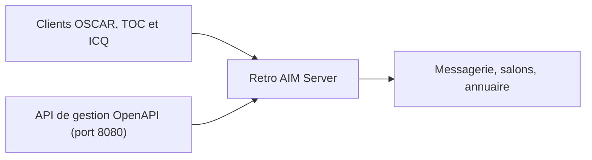

# mk6i/retro-aim-server

> Serveur de messagerie en Go compatible avec les clients AIM et ICQ classiques, pour nostalgiques.

## Le problème
Les clients AIM et ICQ d'époque n'ont plus de serveur officiel.

## Ce que ça fait vraiment
Implémente le protocole OSCAR : messagerie, listes d'amis, salons, profils, messages d'absence, icônes, recherche d'annuaire, transfert de fichiers, clients TOC1/TOC2 et ICQ. Une API de gestion (OpenAPI) sur le port 8080 permet de créer des utilisateurs, changer les mots de passe, lister sessions et salons. Non affilié à AOL ni Yahoo.

## Comment c'est branché
Schéma simplifié d'après la fiche, sans diagramme fourni.



## Essayer
```bash
curl http://localhost:8080/user
curl -d'{"screen_name":"MyScreenName", "password":"thepassword"}' http://localhost:8080/user
curl http://localhost:8080/session
```

## Coût et pièges
Gratuit. L'API de gestion en HTTP clair sur localhost n'a pas d'authentification documentée.

## Ce que ce n'est pas
Pas un messager moderne : il ne sert que des clients d'époque. Le README affirme être sans revenu ni dons.

## Alternatives
Aucune alternative nommée dans le README.

## Pour toi
À ignorer : serveur rétro sans lien avec la data ou l'IA.

