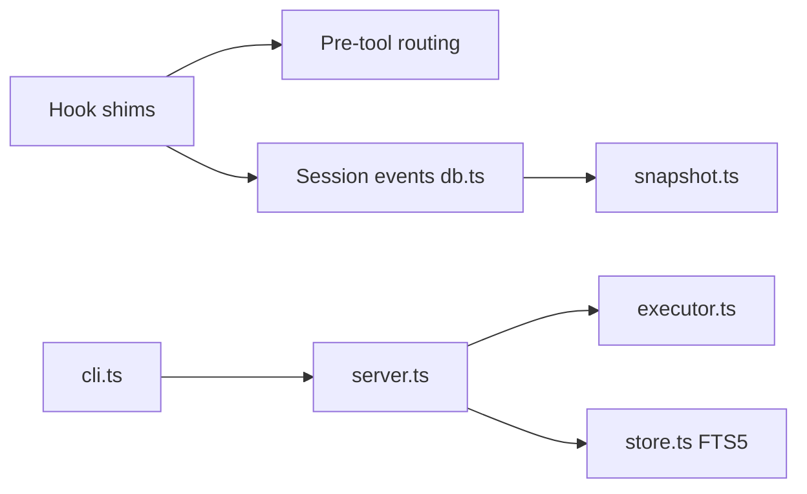

# mksglu/context-mode

> MCP server and hooks that keep bulky outputs out of the agent's context and restore state after compaction.

## The problem
Every tool call dumps tens of KB into the context window, and the agent forgets files and tasks at compaction.

## What it actually does
Provides 11 MCP tools (`ctx_execute`, `ctx_batch_execute`, `ctx_search`, `ctx_fetch_and_index`…). Code runs in a subprocess; only stdout comes back. Contents are indexed in SQLite FTS5 (BM25 + trigrams, RRF). Hooks capture session events and rebuild a summary after compaction. About fifteen supported clients, with uneven levels of coverage.

## How it is wired


## Trying it
```bash
/plugin marketplace add mksglu/context-mode
/plugin install context-mode@context-mode
claude mcp add context-mode -- npx -y context-mode
```

## Cost and gotchas
Free, local; the README claims no telemetry. Node >= 22.5 required (Linux). Without hooks, routing relies on instructions alone (~60% compliance). The sandboxes run arbitrary code: keep the host's sandboxing.

## What it is not
Not a long-term memory: data from a previous session is deleted without `--continue`. The reduction figures come from its own benchmarks. The license is not identified by GitHub.

## Alternatives
No alternative named in the README.

## For you
Worth watching: very useful if your agent sessions saturate the context, but the unidentified license and the dependence on hooks specific to each client call for verification.
