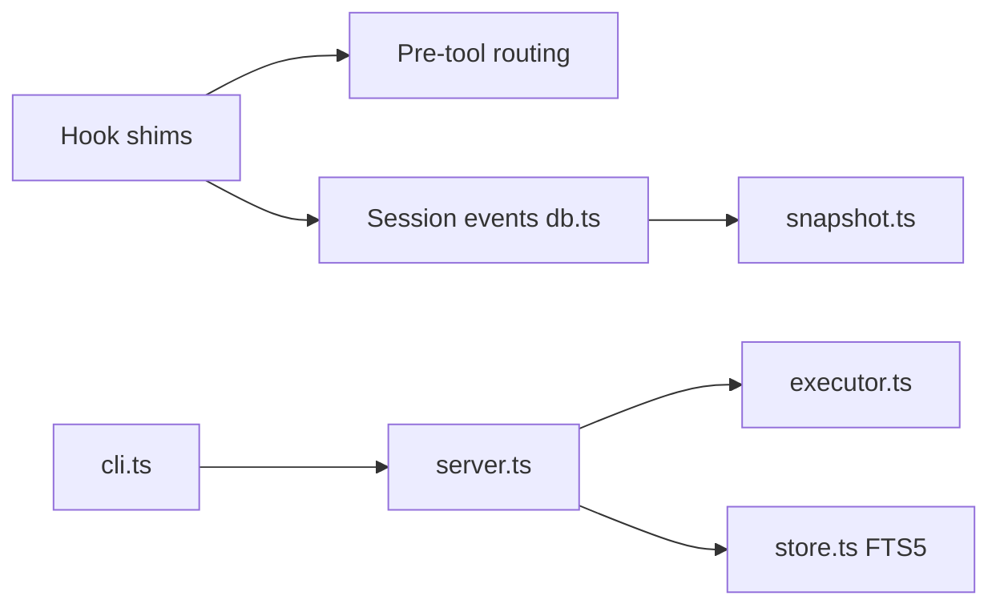

# mksglu/context-mode

> Serveur MCP et hooks qui gardent les sorties volumineuses hors du contexte de l'agent et restaurent l'état après compaction.

## Le problème
Chaque appel d'outil déverse des dizaines de Ko dans la fenêtre de contexte, et l'agent oublie fichiers et tâches à la compaction.

## Ce que ça fait vraiment
Fournit 11 outils MCP (`ctx_execute`, `ctx_batch_execute`, `ctx_search`, `ctx_fetch_and_index`…). Le code s'exécute en sous-processus ; seul stdout revient. Les contenus sont indexés dans SQLite FTS5 (BM25 + trigrammes, RRF). Des hooks capturent les événements de session et reconstruisent un résumé après compaction. Une quinzaine de clients supportés, avec des niveaux de couverture inégaux.

## Comment c'est branché


## Essayer
```bash
/plugin marketplace add mksglu/context-mode
/plugin install context-mode@context-mode
claude mcp add context-mode -- npx -y context-mode
```

## Coût et pièges
Gratuit, local ; le README affirme aucune télémétrie. Node ≥ 22.5 requis (Linux). Sans hooks, le routage ne repose que sur des instructions (~60 % de conformité). Les sandbox exécutent du code arbitraire : garder le sandboxing de l'hôte.

## Ce que ce n'est pas
Pas une mémoire de long terme : les données d'une session précédente sont supprimées sans `--continue`. Les chiffres de réduction viennent de ses propres benchmarks. La licence n'est pas identifiée par GitHub.

## Alternatives
Aucune alternative nommée dans le README.

## Pour toi
À surveiller : très utile si tes sessions d'agent saturent le contexte, mais la licence non identifiée et la dépendance à des hooks propres à chaque client demandent vérification.

