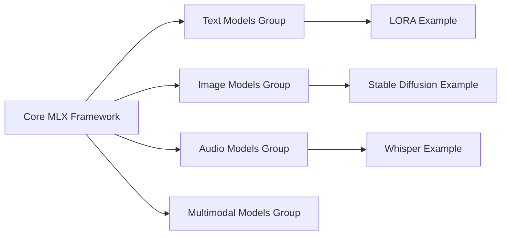

# ml-explore/mlx-examples

> Collection of standalone examples from Apple for training and running models with MLX on Apple silicon.

## The problem
Getting started with MLX requires concrete examples for each model family; without them you fall back on PyTorch out of reflex.

## What it actually does
One standalone folder per example: Transformer LM, LLaMA/Mistral/Mixtral, LoRA and QLoRA, T5, BERT, FLUX, Stable Diffusion/SDXL, ResNet CIFAR-10, CVAE, Wan2.1 video, Whisper, EnCodec, MusicGen, CLIP, LLaVA, SAM, GCN, Real NVP. Each folder has its own README and dependencies. Recommended entry point: MNIST. Converted weights are on the Hugging Face organization `mlx-community`.

## How it is wired

## Trying it
No command documented in the root README: each example has its instructions in its own folder.

## Cost and gotchas
Free; assumes an Apple silicon Mac to benefit from MLX. Dependencies vary from one example to another.

## What it is not
Not an installable library nor a stable API: independent examples. For LLMs, the README itself points to MLX LM.

## Alternatives
- ml-explore/mlx-lm: a more complete Python package for LLMs with MLX.

## For you
Worth watching if you work on a Mac: a good catalog for prototyping locally (LoRA, Whisper, SD), but for LLMs prefer mlx-lm, which the README recommends.
