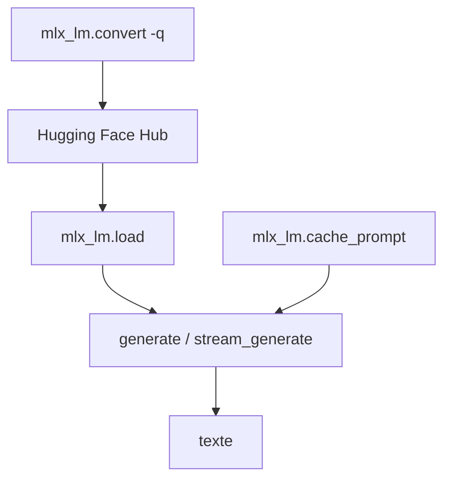

# ml-explore/mlx-lm

> Python package to generate text and fine-tune LLMs on Apple silicon with MLX.

## The problem
Running and fine-tuning LLMs locally on Apple Silicon Macs lacks simple tools; CUDA stacks do not run there and the alternatives are scattered.

## What it actually does
Hugging Face Hub integration: an LLM in a single command. Quantization and upload of models to the Hub. LoRA and full fine-tuning, including on quantized models. Distributed inference and fine-tuning via `mx.distributed`. Python API (`load`, `generate`, `stream_generate`), CLI (`mlx_lm.generate`, `mlx_lm.chat`, `mlx_lm.convert`), prompt cache, rotating KV-cache for long contexts.

## How it is wired


## Trying it
```sh
pip install mlx-lm
```
```bash
mlx_lm.generate --prompt "How tall is Mt Everest?"
```

## Cost and gotchas
Free. Apple chip required. Large models can be slow; `sudo sysctl iogpu.wired_limit_mb=N` (macOS 15+) helps. RAM is the limiting factor.

## What it is not
Not cross-platform: it is Apple Silicon only. Not a turnkey server (although an `mlx_lm.server` exists).

## Alternatives
Not named in the README.

## For you
Excellent if you work on an Apple Silicon Mac to prototype, quantize and fine-tune LLMs locally — adopt it in that case.
