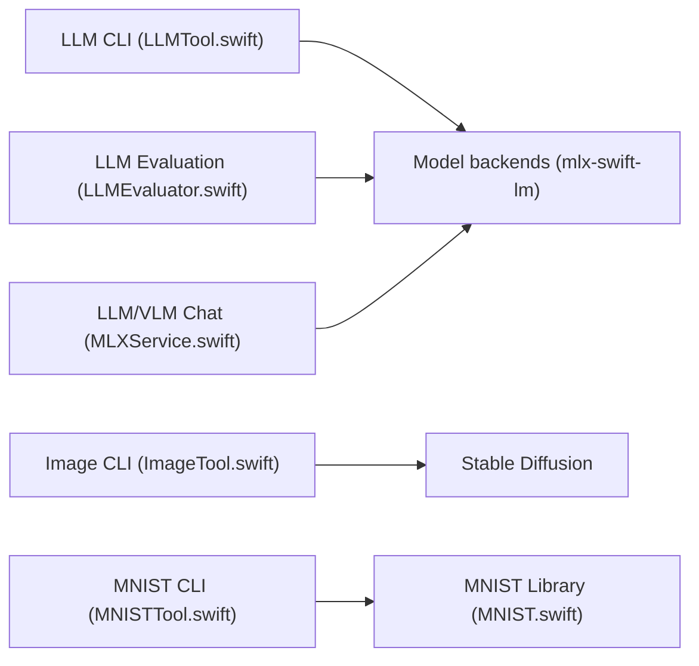

# ml-explore/mlx-swift-examples

> Example apps and tools for MLX Swift (LLM, diffusion, MNIST) for Apple developers.

## The problem
Knowing how to run models on Apple Silicon from Swift, on iOS and macOS.

## What it actually does
A collection of examples: MNISTTrainer, LLMBasic, LLMEval, MLXChatExample (LLM and VLM), LoRATrainingExample, StableDiffusionExample, command-line tools `llm-tool`, `image-tool`, `mnist-tool`, and numerical demos (CurveFit, HeatTransfer, Mandelbrot with a Metal kernel). The LLM/VLM/embedders libraries have migrated to the mlx-swift-lm repository; StableDiffusion and MLXMNIST remain.

## How it is wired


## Trying it
```bash
./mlx-run llm-tool --prompt "swift programming language"
```

## Cost and gotchas
Free; Xcode and a Mac required. Models are downloaded from Hugging Face at runtime.

## What it is not
Not a product: these are examples. The model libraries have moved to mlx-swift-lm.

## Alternatives
- mlx-swift-lm: new repository of the reusable LLM/VLM libraries.

## For you
Keep an eye on it: a useful reference if you target embedded ML on Apple, of no interest for MLOps outside the Apple ecosystem.
