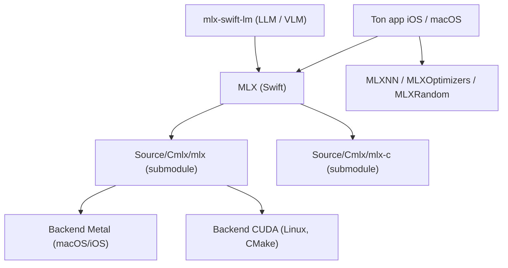

# ml-explore/mlx-swift

> Swift API for MLX, the array framework for machine learning on Apple chips.

## The problem
MLX is in Python; writing an iOS or macOS app that runs a model locally used to require going through a bridge.

## What it actually does
Ports MLX to Swift to make research and experimentation more direct on Apple silicon. The package exposes `MLX`, `MLXNN`, `MLXOptimizers` and `MLXRandom`. The LLM and VLM implementations live in a separate repository, `mlx-swift-lm`. The examples, also hosted elsewhere (MLX Swift Examples), cover training a LeNet on MNIST, an LLM/VLM chat app, text generation from a Hugging Face model, Stable Diffusion, and a command-line tool `llm-tool`. Three ways to build: Xcode, SwiftPM, or CMake — the latter offering a native Linux build option, with a CPU backend by default and a CUDA backend exclusive to Linux.

## How it is wired


## Trying it
```bash
git submodule update --init --recursive
xcodebuild test -scheme mlx-swift-Package -destination 'platform=OS X'
brew install cmake
brew install ninja
mkdir -p build && cd build && cmake .. -G Ninja && ninja && ./tutorial
cmake -DMLX_BUILD_METAL=OFF -DMLX_BUILD_CUDA=ON -DMLX_C_BUILD_EXAMPLES=OFF .. -G Ninja
```

## Cost and gotchas
Free. **Command-line SwiftPM cannot compile Metal shaders**: the final build must go through Xcode or `xcodebuild`. Documented pitfall: if your app and an intermediate framework both link MLX, you end up with two copies of MLX in the same process, hence the `xcode/MLX.xcodeproj` project to build it as a Framework.

## What it is not
It is not a model library: the LLMs and VLMs are elsewhere. Nor is it a partial port — the README states that all the capabilities of MLX Python should be available, and invites you to open an issue if not. The examples are not in this repository.

## Alternatives
- MLX (Python), for anything that does not need to be embedded in an Apple app.
- `mlx-swift-lm`, if what you are after is the language models.

## For you
Off-topic on Linux; relevant only if you embed inference in an Apple app.
