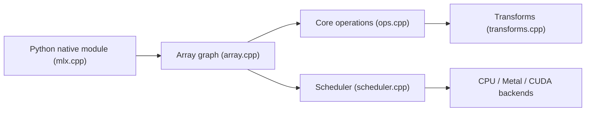

# ml-explore/mlx

> Array framework for machine learning on Apple silicon, with a NumPy-like Python API.

## The problem
Training and running models on a Mac requires a framework that exploits Apple's unified memory and GPU.

## What it actually does
MLX builds lazy, dynamic computation graphs, with automatic differentiation, vectorization and compilation. Unified memory avoids copies between CPU and GPU. CPU, Metal and CUDA backends; Python, C++, C and Swift APIs; `mlx.nn` and `mlx.optimizers` close to PyTorch; optional distributed collectives, safetensors and GGUF formats.

## How it is wired


## Trying it
```bash
pip install mlx
pip install mlx[cuda]
pip install mlx[cpu]
```

## Cost and gotchas
Free. Optimal on Apple silicon; the CUDA and Linux CPU variants exist but the ecosystem is younger than PyTorch's.

## What it is not
Not a platform of ready-to-use models: the examples (LLaMA, Whisper, Stable Diffusion) live in a separate repository.

## Alternatives
No alternative named in the README; PyTorch, JAX, NumPy and ArrayFire are cited as sources of inspiration.

## For you
To adopt if you work on a Mac: MIT, familiar API and efficient local LLM execution.
