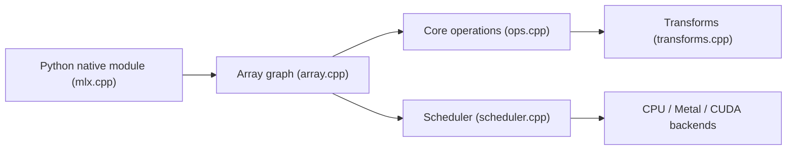

# ml-explore/mlx

> Framework de tableaux pour le machine learning sur Apple silicon, avec API Python proche de NumPy.

## Le problème
Entraîner et exécuter des modèles sur un Mac demande un framework qui exploite la mémoire unifiée et le GPU Apple.

## Ce que ça fait vraiment
MLX construit des graphes de calcul paresseux et dynamiques, avec différentiation automatique, vectorisation et compilation. Une mémoire unifiée évite les copies entre CPU et GPU. Backends CPU, Metal et CUDA ; API Python, C++, C et Swift ; `mlx.nn` et `mlx.optimizers` proches de PyTorch ; collectives distribuées optionnelles, formats safetensors et GGUF.

## Comment c'est branché


## Essayer
```bash
pip install mlx
pip install mlx[cuda]
pip install mlx[cpu]
```

## Coût et pièges
Gratuit. Optimal sur Apple silicon ; les variantes CUDA et CPU Linux existent mais l'écosystème est plus jeune que PyTorch.

## Ce que ce n'est pas
Pas une plateforme de modèles prêts à l'emploi : les exemples (LLaMA, Whisper, Stable Diffusion) sont dans un dépôt séparé.

## Alternatives
Aucune alternative nommée dans le README ; PyTorch, JAX, NumPy et ArrayFire sont cités comme sources d'inspiration.

## Pour toi
À adopter si tu travailles sur Mac : MIT, API familière et exécution locale de LLM efficace.

