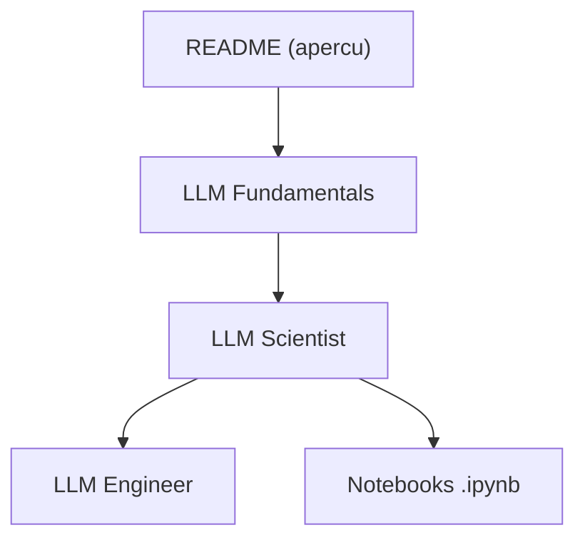

# mlabonne/llm-course

> Free course with three different tracks (fundamentals, scientific, and engineering), along with notebooks to help you master large language models (LLMs).

## The problem
The path from basic mathematics to fine-tuning, quantization, and deployment of LLMs is fragmented.

## What it actually does
Three tracks: fundamental (maths, Python, neural networks, NLP), scientific (architecture, pre-training, post-training data, SFT, DPO/GRPO/PPO alignment, evaluation, quantization), and engineering. Colab notebooks cover Unsloth, ORPO, DPO, QLoRA, Axolotl, GPTQ, GGUF, ExLlamaV2, MergeKit, and abliteration. The provided README is truncated during the quantization process: the engineering section has not been read.

## How it is wired

## Trying it
No commands required: open the relevant Colab notebooks as described in the README (AutoQuant, LazyAxolotl, fine-tuning Llama 3.1 with Unsloth...).

## Cost and gotchas
Free, but the fine-tuning notebooks require a Colab or RunPod GPU. The last update was on 2026-02-05: some notebooks may become outdated.

## What it is not
Not a single library or unified code: a list of independent resources and notebooks. The associated book is for sale.

## Alternatives
No alternative is specified in the README file.

## For you
Recommended: A complete LLM skill development pathway, with directly executable notebooks.
