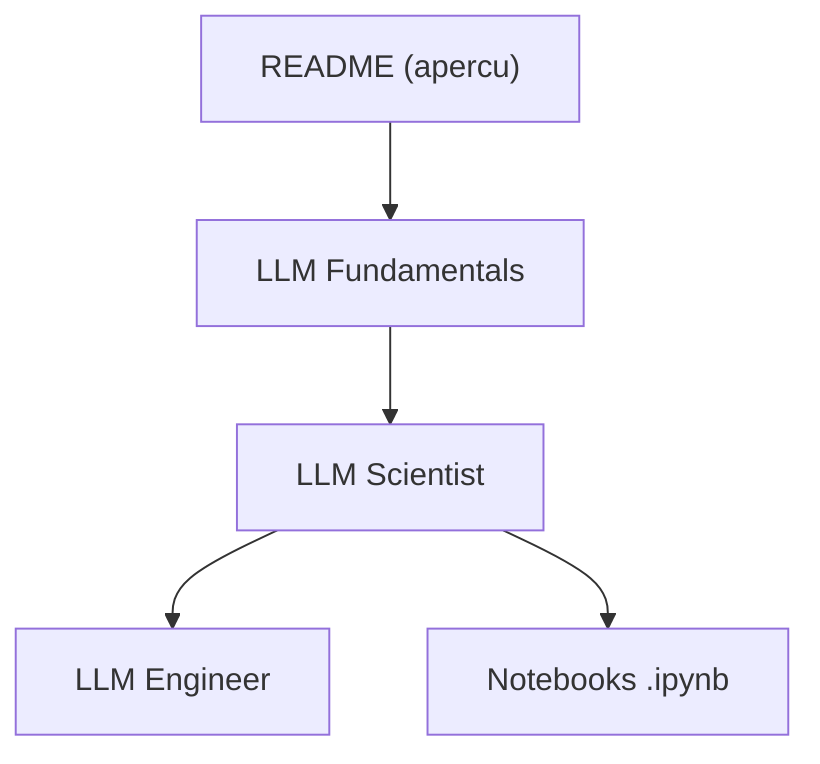

# mlabonne/llm-course

> Cours gratuit en trois parcours (fondamentaux, scientifique, ingénieur) avec notebooks pour maîtriser les LLM.

## Le problème
Le chemin pour passer des maths de base au fine-tuning, à la quantification et au déploiement de LLM est éparpillé.

## Ce que ça fait vraiment
Trois parcours : fondamentaux (maths, Python, réseaux de neurones, NLP), scientifique (architecture, pré-entraînement, données post-training, SFT, alignement DPO/GRPO/PPO, évaluation, quantification) et ingénieur. Des notebooks Colab couvrent Unsloth, ORPO, DPO, QLoRA, Axolotl, GPTQ, GGUF, ExLlamaV2, MergeKit, abliteration. Le README fourni est tronqué en cours de quantification : la partie ingénieur n'est pas lue.

## Comment c'est branché

## Essayer
Aucune commande : ouvrir les notebooks Colab liés dans le README (AutoQuant, LazyAxolotl, fine-tuning Llama 3.1 avec Unsloth...).

## Coût et pièges
Gratuit, mais les notebooks de fine-tuning demandent un GPU Colab ou RunPod. Dernier push le 2026-02-05 : certains notebooks peuvent vieillir.

## Ce que ce n'est pas
Pas une bibliothèque ni un code unifié : une liste de ressources et de notebooks indépendants. Le livre associé est payant.

## Alternatives
Aucune alternative nommée dans le README.

## Pour toi
À adopter : parcours de référence pour monter en compétence LLM de bout en bout, avec des notebooks directement exécutables.

