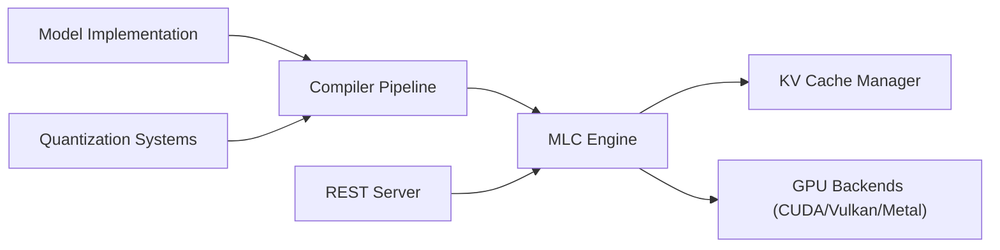

# mlc-ai/mlc-llm

> Compiler and inference engine to deploy LLMs natively on GPU, mobile and browser.

## The problem
Running the same LLM on CUDA, Metal, Vulkan, WebGPU, iOS and Android requires a different stack per target and a lot of manual optimization.

## What it actually does
Compiles the model through an ML pipeline (TensorIR, optimization passes) to each platform.
Runs the result on MLCEngine, which exposes an OpenAI-compatible API: REST server, Python, JavaScript, iOS, Android.
Handles quantization, tokenizers and the KV cache (architecture).
The README is short: installation and getting started are deferred to the documentation.

## How it is wired

## Trying it
No command documented in the README: it points to the Installation and Quick start pages.

## Cost and gotchas
Free, but you need a GPU (or a mobile device / WebGPU browser). Per-target compilation adds a step absent from classic engines.

## What it is not
Not a training tool. Not a simple `pip install` that works everywhere: each platform has its constraints. The README gives neither figures nor a runnable example.

## Alternatives
No alternative named in the README.

## For you
Worth watching: relevant if you must embed an LLM on mobile or in a browser; for classic server-side serving, the README's content is not enough to decide.
