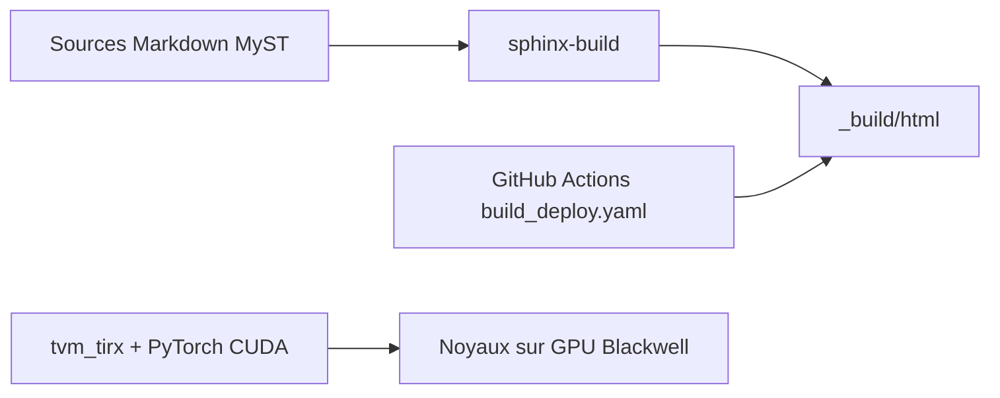

# mlc-ai/modern-gpu-programming-for-mlsys

> Online book for learning Blackwell GPU kernel programming with the TIRx Python DSL.

## The problem
Writing modern GPU kernels (TMA, Tensor Memory, clusters) requires understanding the hardware, and few resources teach it progressively.

## What it actually does
A Sphinx book in four parts: understanding the GPU, programming with TIRx, GEMM up to the state of the art, then Flash Attention 4. Appendices cover the language reference, benchmarking and asynchronous debugging. Also available in Chinese.

## How it is wired
Simplified diagram based on the fiche, no diagram provided.



## Trying it
```bash
pip install -r requirements-docs.txt
sphinx-build -b html . _build/html
python -m http.server -d _build/html 8000
pip install apache-tvm-tirx cuda-bindings
```

## Cost and gotchas
Reading costs nothing. Running the kernels requires a Blackwell GPU (B200 class), PyTorch CUDA and the TIRx compiler.

## What it is not
Not a ready-to-use kernel library: those live in the TIRx-kernels repository. No license is declared in the catalog, so reuse of the text is not guaranteed.

## Alternatives
No alternative named in the README.

## For you
Adopt as reading: a rare reference for understanding what happens under inference and attention, even without access to Blackwell hardware.
