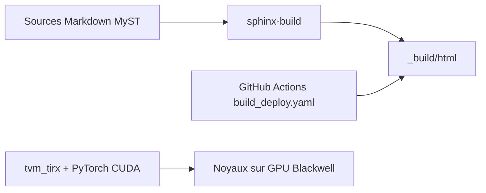

# mlc-ai/modern-gpu-programming-for-mlsys

> Livre en ligne pour apprendre la programmation de noyaux GPU Blackwell avec le DSL Python TIRx.

## Le problème
Écrire des noyaux GPU modernes (TMA, Tensor Memory, clusters) demande de comprendre le matériel, et peu de supports le font de façon progressive.

## Ce que ça fait vraiment
Un livre Sphinx en quatre parties : comprendre le GPU, programmer avec TIRx, GEMM jusqu'à l'état de l'art, puis Flash Attention 4. Des annexes couvrent la référence du langage, le benchmark et le débogage asynchrone. Existe aussi en chinois.

## Comment c'est branché
Schéma simplifié d'après la fiche, sans diagramme fourni.



## Essayer
```bash
pip install -r requirements-docs.txt
sphinx-build -b html . _build/html
python -m http.server -d _build/html 8000
pip install apache-tvm-tirx cuda-bindings
```

## Coût et pièges
Lire ne coûte rien. Exécuter les noyaux exige un GPU Blackwell (type B200), PyTorch CUDA et le compilateur TIRx.

## Ce que ce n'est pas
Pas une bibliothèque de noyaux prête à l'emploi : ceux-ci sont dans le dépôt TIRx-kernels. Aucune licence n'est déclarée dans le catalogue, donc réutilisation du texte non garantie.

## Alternatives
Aucune alternative nommée dans le README.

## Pour toi
À adopter en lecture : référence rare pour comprendre ce qui se joue sous l'inférence et l'attention, même sans accès à du matériel Blackwell.

