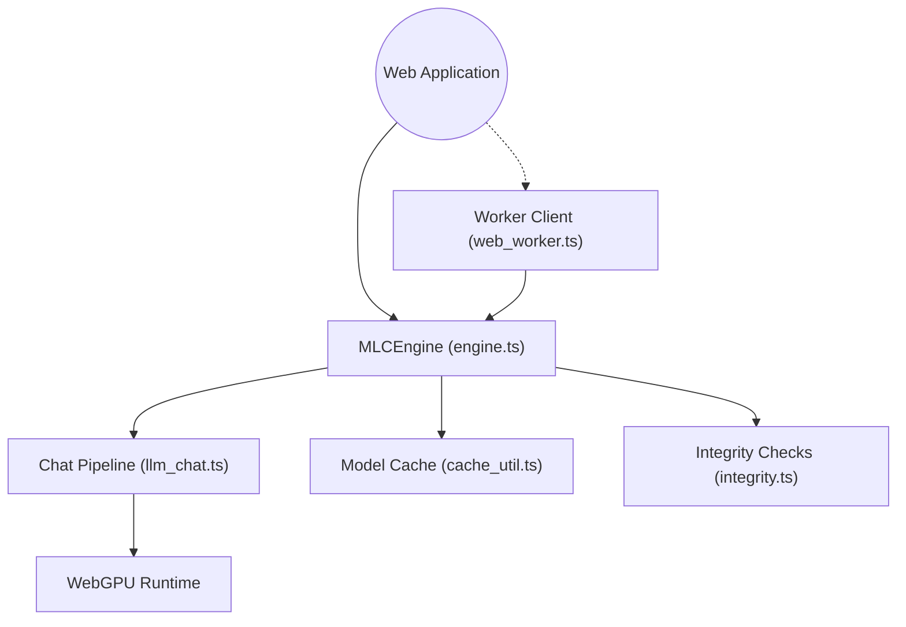

# mlc-ai/web-llm

> In-browser LLM inference engine via WebGPU, with an OpenAI-compatible API, for web developers.

## The problem
Running an LLM client-side avoids paying for a server and keeps data from leaving, but requires an engine adapted to the browser.

## What it actually does
`MLCEngine` loads a model in MLC format, caches it in the browser (Cache API, IndexedDB, OPFS) and exposes `engine.chat.completions` like the OpenAI API, with streaming and JSON mode. Workers (Web Worker, Service Worker, Chrome extension) offload the computation. An integrity check by SRI hash is optional. Function calling is still under development.

## How it is wired


## Trying it
```bash
npm install @mlc-ai/web-llm
```
```typescript
import { CreateMLCEngine } from "@mlc-ai/web-llm";
const engine = await CreateMLCEngine("Llama-3.1-8B-Instruct-q4f32_1-MLC");
const reply = await engine.chat.completions.create({ messages });
```

## Cost and gotchas
Free. You need a browser with WebGPU and a decent GPU. The first load downloads the model weights: slow. The Service Worker can be killed by the browser.

## What it is not
Not an inference server: everything runs on the user's machine. No full compatibility guaranteed despite the name: function calling is incomplete, and the model catalogue is limited to MLC formats.

## Alternatives
- MLC-LLM: native execution on other hardware.
- Web Stable Diffusion: same family, for images.

## For you
Adopt for demos, private assistants or extensions running without a server: stable, familiar OpenAI API, Apache-2.0 license.
