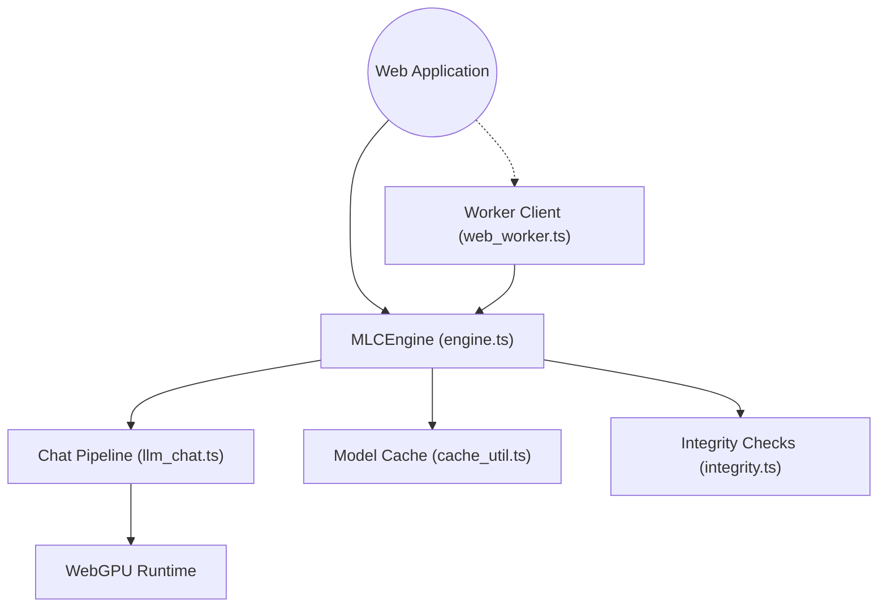

# mlc-ai/web-llm

> Moteur d'inférence LLM dans le navigateur via WebGPU, avec une API compatible OpenAI, pour développeurs web.

## Le problème
Faire tourner un LLM côté client évite de payer un serveur et de faire sortir les données, mais demande un moteur adapté au navigateur.

## Ce que ça fait vraiment
`MLCEngine` charge un modèle au format MLC, le met en cache dans le navigateur (Cache API, IndexedDB, OPFS) et expose `engine.chat.completions` comme l'API OpenAI, avec streaming et mode JSON. Des workers (Web Worker, Service Worker, extension Chrome) déportent le calcul. Une vérification d'intégrité par hash SRI est optionnelle. L'appel de fonctions reste en cours de développement.

## Comment c'est branché


## Essayer
```bash
npm install @mlc-ai/web-llm
```
```typescript
import { CreateMLCEngine } from "@mlc-ai/web-llm";
const engine = await CreateMLCEngine("Llama-3.1-8B-Instruct-q4f32_1-MLC");
const reply = await engine.chat.completions.create({ messages });
```

## Coût et pièges
Gratuit. Il faut un navigateur avec WebGPU et un GPU correct. Le premier chargement télécharge les poids du modèle : long. Le Service Worker peut être tué par le navigateur.

## Ce que ce n'est pas
Pas un serveur d'inférence : tout s'exécute chez l'utilisateur. Pas de compatibilité complète garantie malgré le nom : l'appel de fonctions est incomplet, et le catalogue de modèles est limité aux formats MLC.

## Alternatives
- MLC-LLM : exécution native sur d'autres matériels.
- Web Stable Diffusion : même famille, pour l'image.

## Pour toi
À adopter pour des démos, des assistants privés ou des extensions tournant sans serveur : stable, API OpenAI connue, licence Apache-2.0.

