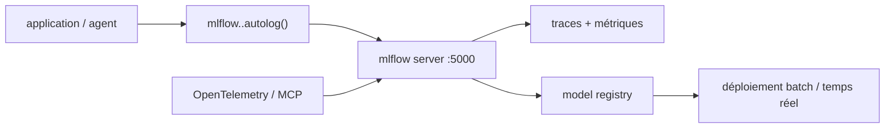

# mlflow/mlflow

> Open platform for tracking, evaluating and deploying models, LLMs and agents.

## The problem
An agent's traces live in each framework's logs, with no common view and no way to compare them.
Finding which parameter set produced which model, six months later, is archaeology.

## What it actually does
A local server (`mlflow server`) collects traces and metrics, viewable in a UI at `localhost:5000`.
One-line automatic tracing for more than 60 frameworks (LangChain, LangGraph, DSPy, CrewAI, LlamaIndex, OpenAI Agents…), in Python, TypeScript, Java.
For classic models: experiment tracking, evaluation, model registry, deployment to Docker/Kubernetes/SageMaker/Azure ML.
For LLMs: observability, evaluation, prompt management and optimization, an AI gateway to control costs and access.

## How it is wired


## Trying it
```bash
uvx mlflow server
curl -LsSf https://mlflow.org/wizard/setup.sh | sh
```

## Cost and gotchas
Free and vendor-neutral; the local server needs no key or account.
The setup wizard downloads and runs a remote script, then launches your coding agent on your repository.

## What it is not
It is not a managed offering: hosting (local, on-premise, Databricks, SageMaker, Azure ML, Nebius, OpenShift AI) remains your problem.
It is not a training tool: it observes, evaluates and versions, it does not compute.
Tracing is not magic: autolog covers the listed frameworks, the rest requires instrumentation.

## Alternatives
Langfuse, Arize/Phoenix: cited as integrated tools, they also cover LLM observability.
LiteLLM Proxy, OpenRouter, Portkey: alternative gateways if you only care about cost control.

## For you
The default foundation for tracing agents and experiments: start with `uvx mlflow server` and an `autolog()`.
