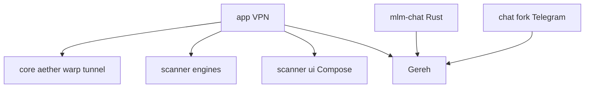

# mlmvpn/mlmvpn_android

> Multi-engine Android application for VPN, network scanner and serverless messaging, for filtered networks.

## The problem
Find a route that works on a restricted network, with many protocols and engines to try by hand.

## What it actually does
Bundles engines (V2Ray and Xray, WARP, WireGuard, Amnezia, Tor, Psiphon, Outline), a clean-IP scanner, a Cloudflare and Gereh panel, and an encrypted phone-to-phone messenger. Server addresses are replaced by dummy values in the repository. The native binaries are not in the repository.

## How it is wired


## Trying it
```bash
git clone https://github.com/mlmvpn/mlmvpn_android.git
cd mlmvpn_android
./gradlew assembleDebug
```

## Cost and gotchas
Free. Several engines require your own accounts (Cloudflare, Firefox, Proton, GitHub). Git LFS required for the native libraries. GPLv3 with an attribution clause. Use remains subject to the laws of your country.

## What it is not
Not a turnkey VPN service nor a tool ready to build on its own: the binaries come from the releases.

## Alternatives
No alternative named in the README.

## For you
Ignore: network circumvention application, unrelated to data, AI or MLOps work.
