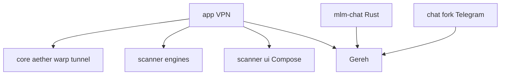

# mlmvpn/mlmvpn_android

> Application Android multi-moteurs VPN, scanner réseau et messagerie sans serveur, pour réseaux filtrés.

## Le problème
Trouver une route qui fonctionne sur un réseau restreint, avec de nombreux protocoles et moteurs à essayer à la main.

## Ce que ça fait vraiment
Regroupe des moteurs (V2Ray et Xray, WARP, WireGuard, Amnezia, Tor, Psiphon, Outline), un scanner d'IP propres, un panneau Cloudflare et Gereh, une messagerie chiffrée de téléphone à téléphone. Les adresses des serveurs sont remplacées par des valeurs fictives dans le dépôt. Les binaires natifs ne sont pas dans le dépôt.

## Comment c'est branché


## Essayer
```bash
git clone https://github.com/mlmvpn/mlmvpn_android.git
cd mlmvpn_android
./gradlew assembleDebug
```

## Coût et pièges
Gratuit. Plusieurs moteurs demandent tes propres comptes (Cloudflare, Firefox, Proton, GitHub). Git LFS requis pour les bibliothèques natives. GPLv3 avec clause d'attribution. L'usage reste soumis aux lois de ton pays.

## Ce que ce n'est pas
Pas un service VPN clé en main ni un outil prêt à compiler seul : les binaires viennent des releases.

## Alternatives
Aucune alternative nommée dans le README.

## Pour toi
À ignorer : application de contournement réseau, sans lien avec un travail data, IA ou MLOps.

