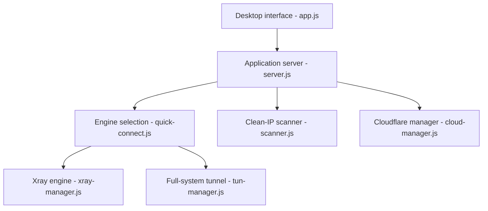

# mlmvpn/mlmvpn_windows

> Windows application bundling fourteen anti-censorship engines, a clean-IP scanner and a Cloudflare manager.

## The problem
No single transport works everywhere on filtered networks: you have to try several and know which one works here and now.

## What it actually does
Electron application with a local Express server that drives external engines (Xray-core, sing-box, WARP, Psiphon, Tor, Lantern, Geph, OpenVPN…), measures latency and throughput, routes per application or through a full tunnel, with a kill switch and DNS guard. A scanner looks for healthy CDN IPs; a manager deploys Cloudflare Workers with your own token. The engine binaries are not in the repository.

## How it is wired


## Trying it
```bash
git clone https://github.com/mlmvpn/mlmvpn_windows.git
cd mlmvpn_windows
npm install
npm run electron
npm test
```

## Cost and gotchas
Administrator rights required (TUN, firewall, DNS), Node 18+, about 1.5 GB. The binaries in `core/` must be supplied (docs/BUILD.md). A license is present but not identified. Cloudflare account and API token needed for the cloud part.

## What it is not
Not a VPN with its own server: the README says no MLMVPN server is in the data path. The legality of use is your responsibility.

## Alternatives
No alternative named in the README, which does however cite the driven projects (Xray-core, sing-box, Tor, Psiphon).

## For you
Ignore: censorship-circumvention tool for Windows, unrelated to data/AI/MLOps work, with a single maintainer.
