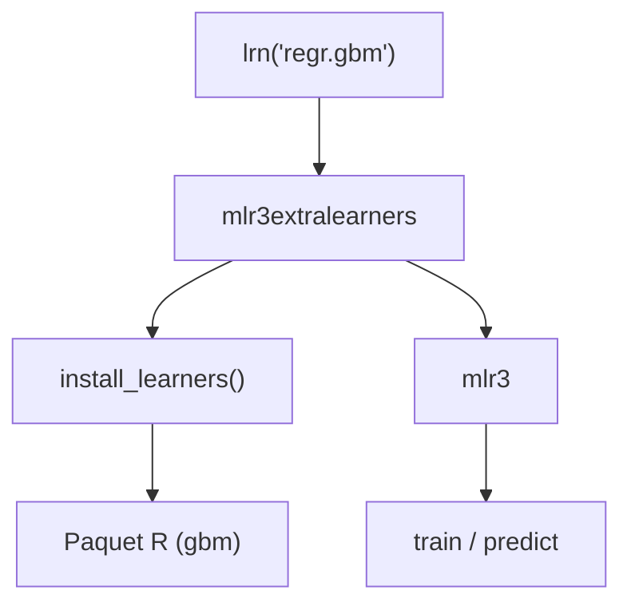

# mlr-org/mlr3extralearners

> Additional models for the R mlr3 ecosystem, for data scientists working in R.

## The problem
The mlr3 core does not include every learning algorithm, and integrating them case by case is tedious.

## What it actually does
Provides the mlr3 "learners" missing from `mlr3learners` and the core. Detects the packages missing for a learner and `install_learners()` installs them. A learner is then used like any other to train and predict. A tutorial explains how to add one.

## How it is wired
Simplified diagram based on the sheet, no diagram provided.



## Trying it
```bash
# commandes R du README :
# pak::pak("mlr-org/mlr3extralearners@*release")
# library(mlr3extralearners); install_learners("regr.gbm")
```

## Cost and gotchas
Free. Not on CRAN: install from GitHub or r-universe. LGPL-3.0, an obligation to be aware of if you redistribute.

## What it is not
Not a Python tool: it only works with R and mlr3, and each learner pulls in its own dependencies.

## Alternatives
No alternative named in the README.

## For you
Watch: useful if you do ML in R with mlr3, otherwise off-topic.
