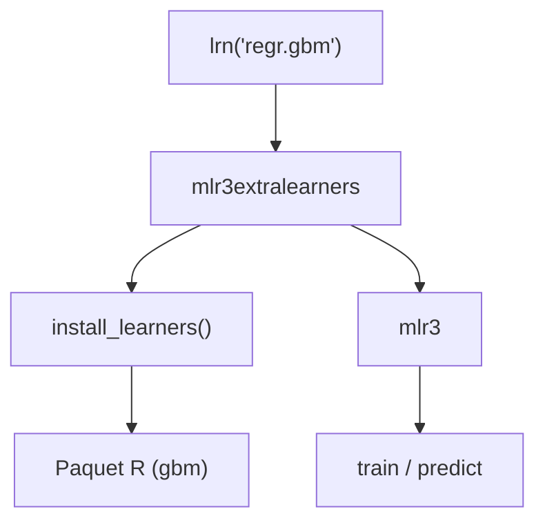

# mlr-org/mlr3extralearners

> Modèles supplémentaires pour l'écosystème R mlr3, pour data scientists travaillant en R.

## Le problème
Le noyau de mlr3 ne contient pas tous les algorithmes d'apprentissage, et leur intégration au cas par cas est fastidieuse.

## Ce que ça fait vraiment
Fournit les « learners » mlr3 absents de `mlr3learners` et du noyau. Détecte les paquets manquants pour un learner et `install_learners()` les installe. Un learner s'utilise ensuite comme un autre pour entraîner et prédire. Un tutoriel explique comment en ajouter.

## Comment c'est branché
Schéma simplifié d'après la fiche, sans diagramme fourni.



## Essayer
```bash
# commandes R du README :
# pak::pak("mlr-org/mlr3extralearners@*release")
# library(mlr3extralearners); install_learners("regr.gbm")
```

## Coût et pièges
Gratuit. Pas sur CRAN : installation depuis GitHub ou r-universe. LGPL-3.0, obligation à connaître en cas de redistribution.

## Ce que ce n'est pas
Pas un outil Python : il ne sert qu'avec R et mlr3, et chaque learner tire ses propres dépendances.

## Alternatives
Aucune alternative nommée dans le README.

## Pour toi
Surveiller : utile si tu fais du ML en R avec mlr3, sinon hors sujet.

