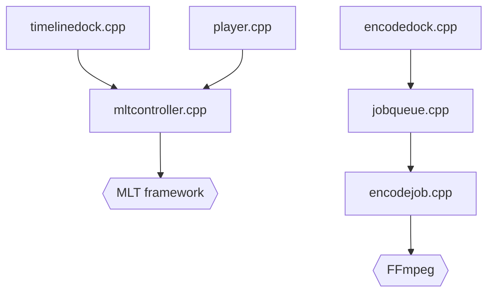

# mltframework/shotcut

> Free, cross-platform video editor built on MLT and FFmpeg, for desktop editing.

## The problem
Editing a video requires an editor without a paid licence that runs on several systems.

## What it actually does
Opens media, assembles it on a timeline, previews and exports. Relies on MLT for projects, FFmpeg for codecs, Qt 6 for the interface. Handles filters, proxies, markers, scopes and an encoding job queue.

## How it is wired


## Trying it
```bash
cmake -DCMAKE_INSTALL_PREFIX=/usr/local/ /path/to/shotcut
cmake --build .
cmake --install .
```
These commands are the build ones; the simplest way is to download the binaries from shotcut.org/download.

## Cost and gotchas
Free. Building is reserved for beta testers and contributors. Without `cmake --install`, the application may not find its QML files.

## What it is not
It is not a video-processing library to embed in a pipeline: it is a graphical application.

## Alternatives
No alternative named in the README.

## For you
Ignore: desktop video editing, unrelated to AI or MLOps.
