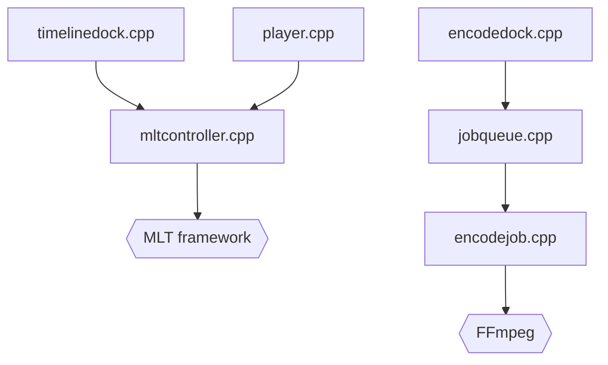

# mltframework/shotcut

> Éditeur vidéo libre et multiplateforme, construit sur MLT et FFmpeg, pour le montage de bureau.

## Le problème
Monter une vidéo demande un éditeur sans licence payante, qui tourne sur plusieurs systèmes.

## Ce que ça fait vraiment
Ouvre des médias, les assemble sur une timeline, prévisualise et exporte. S'appuie sur MLT pour les projets, sur FFmpeg pour les codecs, sur Qt 6 pour l'interface. Gère filtres, proxys, marqueurs, scopes et file de tâches d'encodage.

## Comment c'est branché


## Essayer
```bash
cmake -DCMAKE_INSTALL_PREFIX=/usr/local/ /path/to/shotcut
cmake --build .
cmake --install .
```
Ces commandes sont celles de la compilation ; le plus simple est de télécharger les binaires sur shotcut.org/download.

## Coût et pièges
Gratuit. La compilation est réservée aux testeurs bêta et contributeurs. Sans `cmake --install`, l'application peut ne pas trouver ses fichiers QML.

## Ce que ce n'est pas
Ce n'est pas une bibliothèque de traitement vidéo à intégrer dans un pipeline : c'est une application graphique.

## Alternatives
Aucune alternative nommée dans le README.

## Pour toi
À ignorer : montage vidéo de bureau, sans rapport avec l'IA ou le MLOps.

