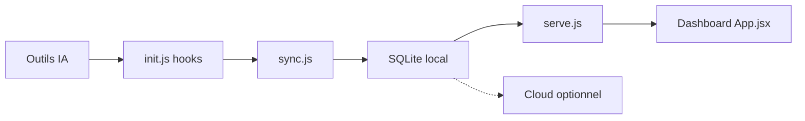

# mm7894215/TokenTracker

> Local dashboard of token consumption and cost for 39 AI coding tools.

## The problem
There is no way to know how many tokens and how much money your coding agents consume across several tools.

## What it actually does
Installs hooks, parses local logs (never prompts) into 30-minute UTC slices in SQLite, and serves a dashboard on `localhost:7680`. Costs from LiteLLM pricing (over 2,200 models), quota tracking for several providers, macOS/Windows/Linux desktop apps, widgets, mascot, achievements, a Skills tab, optional leaderboard and cloud sync.

## How it is wired


## Trying it
```bash
npx tokentracker-cli
npm i -g tokentracker-cli
tokentracker status
tokentracker doctor
```

## Cost and gotchas
Free, Node 20+. Anonymous telemetry on by default (disable with `TOKENTRACKER_NO_TELEMETRY=1`). The macOS app is ad-hoc signed, not notarized; the hooks modify your tools' configuration.

## What it is not
Not a cost-optimization tool; models without a published price show $0.

## Alternatives
ccusage: a CLI with richer terminal reporting; Tokscale: a multi-agent TUI.

## For you
Adopt to measure your coding agents' consumption: local by default, broad coverage; turn off the telemetry.
