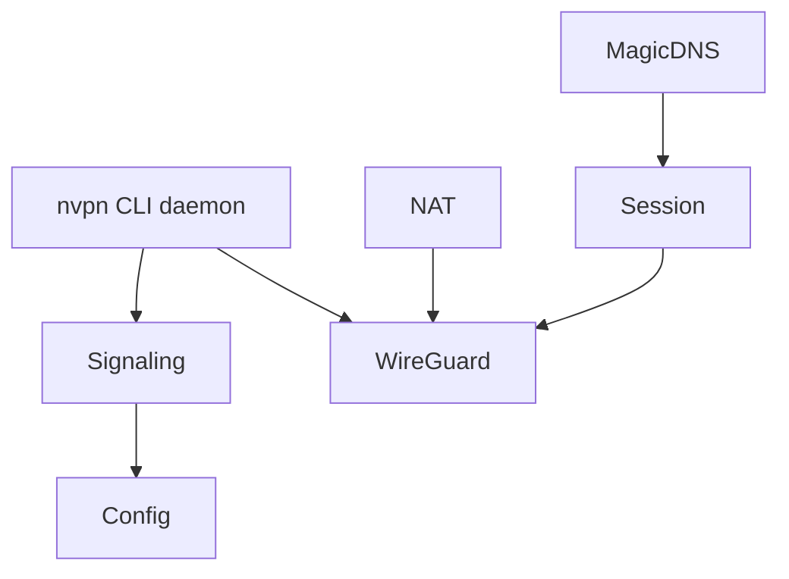

# mmalmi/nostr-vpn

> Private Tailscale-style mesh VPN driven by Nostr identities, to link people, servers and agents.

## The problem
Linking private machines without a provider account or an email address currently goes through a centralised service.

## What it actually does
An `nvpn` CLI with a daemon and native apps (macOS, Linux, Windows, Android, iOS). Enrolment uses signed Nostr lists, traffic goes through userspace WireGuard (`boringtun`), with MagicDNS, subnet routes and exit nodes. An experimental marketplace sells bandwidth for Bitcoin via Cashu.

## How it is wired


## Trying it
```bash
nvpn init
nvpn start --daemon --connect
nvpn join-request
nvpn status
nvpn stop
```

## Cost and gotchas
Free. The container requires root, `/dev/net/tun`, `NET_ADMIN` and `iptables`. The canonical repository is on git.iris.to; GitHub is only a mirror. Paid exits see destination IPs.

## What it is not
Not an anonymising VPN: an exit sees unencrypted traffic. Not mature: the paid marketplace is experimental and DNS may stay local without systemd-resolved.

## Alternatives
No alternative named in the README, apart from the original FIPS project of which it is a fork.

## For you
Ignore: a generic private network unrelated to data or AI, and still experimental.
