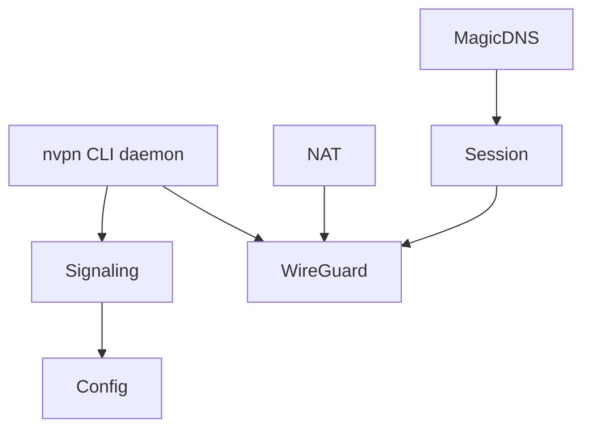

# mmalmi/nostr-vpn

> VPN maillé privé façon Tailscale, piloté par des identités Nostr, pour relier personnes, serveurs et agents.

## Le problème
Relier des machines privées sans compte fournisseur ni adresse e-mail passe aujourd'hui par un service centralisé.

## Ce que ça fait vraiment
Une CLI `nvpn` avec démon et des applications natives (macOS, Linux, Windows, Android, iOS). L'enrôlement passe par des listes signées Nostr, le trafic par WireGuard en espace utilisateur (`boringtun`), avec MagicDNS, routes de sous-réseau et nœuds de sortie. Une place de marché expérimentale vend de la bande passante en Bitcoin via Cashu.

## Comment c'est branché


## Essayer
```bash
nvpn init
nvpn start --daemon --connect
nvpn join-request
nvpn status
nvpn stop
```

## Coût et pièges
Gratuit. Le conteneur exige root, `/dev/net/tun`, `NET_ADMIN` et `iptables`. Le dépôt canonique est sur git.iris.to, GitHub n'est qu'un miroir. Les sorties payantes voient les IP de destination.

## Ce que ce n'est pas
Pas un VPN anonymisant : un exit voit le trafic non chiffré. Pas mûr : le marché payant est expérimental et le DNS peut rester local sans systemd-resolved.

## Alternatives
Aucune alternative nommée dans le README, hormis le projet FIPS d'origine dont il est un fork.

## Pour toi
Ignorer : réseau privé générique sans lien avec la data ou l'IA, et encore expérimental.

