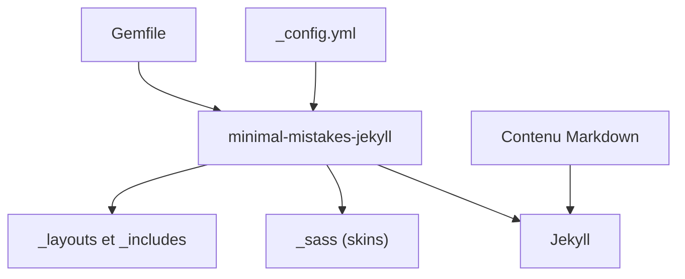

# mmistakes/minimal-mistakes

> A two-column Jekyll theme for blogs, personal sites and portfolios.

## The problem
Setting up a personal site or blog with Jekyll without starting from an empty design.

## What it actually does
A Jekyll theme distributed as a gem or as a remote theme compatible with GitHub Pages. It offers several layouts (post, archives, search, home), skins, header images, a table of contents, galleries, comments (Disqus, Staticman, utterances, giscus), analytics (Google Analytics, Swetrix) and many interface languages.

## How it is wired


## Trying it
```bash
gem "minimal-mistakes-jekyll"
bundle
bundle exec rake preview
```
In `_config.yml`: `theme: minimal-mistakes-jekyll` or `remote_theme: "mmistakes/minimal-mistakes@4.28.1"`.

## Cost and gotchas
Free. You need Ruby and Bundler. The `jekyll-include-cache` plugin must stay in `Gemfile` and in `plugins`, otherwise the build fails with `Unknown tag 'include_cached'`.

## What it is not
Not a site generator: you need Jekyll. Comments and analytics go through third-party services that you must enable.

## Alternatives
- No alternative named in the README.

## For you
Watch: a solid base for a technical blog or a data project portfolio on GitHub Pages, with no AI angle.
