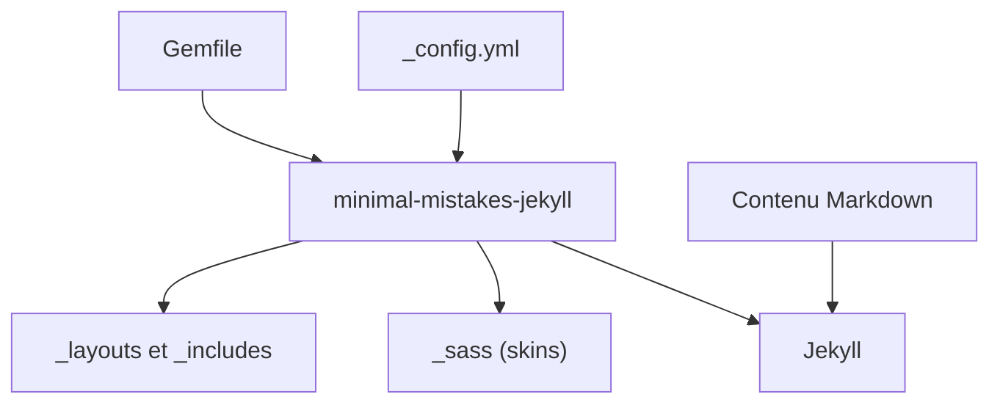

# mmistakes/minimal-mistakes

> Thème Jekyll à deux colonnes pour blogs, sites personnels et portfolios.

## Le problème
Monter un site personnel ou un blog avec Jekyll sans repartir d'un design vide.

## Ce que ça fait vraiment
Thème Jekyll distribué en gem ou en thème distant compatible GitHub Pages. Il offre plusieurs mises en page (article, archives, recherche, accueil), des skins, des images d'en-tête, une table des matières, des galeries, des commentaires (Disqus, Staticman, utterances, giscus), l'analytique (Google Analytics, Swetrix) et de nombreuses langues d'interface.

## Comment c'est branché


## Essayer
```bash
gem "minimal-mistakes-jekyll"
bundle
bundle exec rake preview
```
Dans `_config.yml` : `theme: minimal-mistakes-jekyll` ou `remote_theme: "mmistakes/minimal-mistakes@4.28.1"`.

## Coût et pièges
Gratuit. Il faut Ruby et Bundler. Le plugin `jekyll-include-cache` doit rester dans `Gemfile` et dans `plugins`, sinon la construction échoue avec `Unknown tag 'include_cached'`.

## Ce que ce n'est pas
Pas un générateur de site : il faut Jekyll. Les commentaires et l'analytique passent par des services tiers à activer.

## Alternatives
- Aucune alternative nommée dans le README.

## Pour toi
À surveiller : base solide pour un blog technique ou un portfolio de projets data sur GitHub Pages, sans enjeu d'IA.

