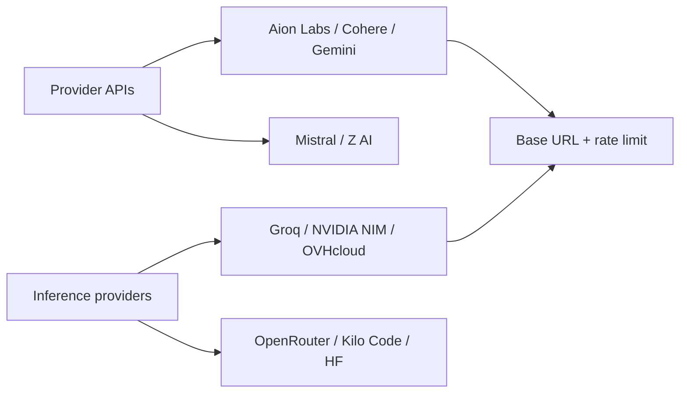

# mnfst/awesome-free-llm-apis

> Catalog of LLM APIs with a free tier, with context, modalities and rate limits.

## The problem
To prototype without a budget, you need to know who offers what, at which limits, and whether the prompts will be used to train the model. This information is scattered and goes stale fast.

## What it actually does
Two tables. First the **providers** that train their own models: Aion Labs, Cohere, Google Gemini, Mistral, Z AI. Then the **inference platforms** that host open-weight models: Cloudflare Workers AI, Groq, Hugging Face, Kilo Code, LLM7.io, ModelScope, NVIDIA NIM, Ollama Cloud, OpenRouter, OVHcloud, SiliconFlow. For each: base URL, model name, context window, maximum output, modality, RPM/RPD/TPM limit. A glossary closes the document.

## How it is wired


## Trying it
```bash
# Rien à installer : les « commandes » sont les URL de base à donner à un SDK
# compatible OpenAI, par exemple https://api.groq.com/openai/v1
# ou https://oai.endpoints.kepler.ai.cloud.ovh.net/v1 (anonyme, 2 RPM).
```

## Cost and gotchas
Free in terms of quotas, not of privacy: prompts on the Gemini free tier may be used to improve Google products, and those on Mistral's free mode to train their models unless you opt out. Cohere is explicitly non-commercial. ModelScope requires an Alibaba Cloud account with identity verification, SiliconFlow identity verification too.

## What it is not
Not code: no gateway, no client. Not an availability guarantee — Ollama Cloud's quotas are not even published. A list like this goes stale in weeks: check each line before relying on it.

## Alternatives
No alternative named in the README.

## For you
Keep it handy for free prototyping — never for sensitive data.
