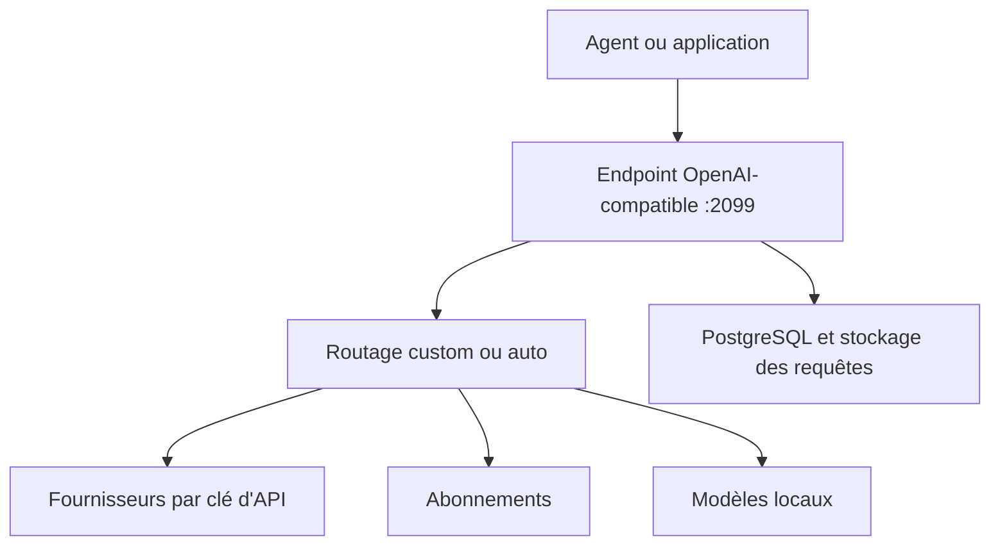

# mnfst/manifest

> Open source LLM gateway: an OpenAI-compatible endpoint that routes each request to the right model.

## The problem
Using several providers, subscriptions and local models means managing as many APIs, bills and error retries.

## What it actually does
Manifest exposes an OpenAI-compatible entry point. With `"model": "auto"`, it chooses the model. It connects more than 300 models through 35 provider connections, 18 subscription plans and local models (Ollama, LM Studio, llama.cpp). It logs request bodies, tracks spending with notifications and limits, and falls back to another model on failure.

## How it is wired
No architecture provided in the block; diagram limited to the README.


## Trying it
```bash
bash <(curl -sSL https://raw.githubusercontent.com/mnfst/llm-gateway/main/docker/install.sh)
```
Then open http://localhost:2099; the first account created becomes the administrator.

## Cost and gotchas
Self-hosted is free; Manifest cloud costs 19 dollars per month. Providers are still billed according to your keys. The old npm path is no longer supported. High-volume deployments are single-instance.

## What it is not
Not a model nor a provider: it redirects to yours. Reused subscriptions may depend on the terms of those services, not detailed here.

## Alternatives
OpenRouter: cited as a provider (300+ models), not as a direct competitor.

## For you
Worth watching: a single entry point with cost tracking is useful in MLOps, to compare with your current gateway.
