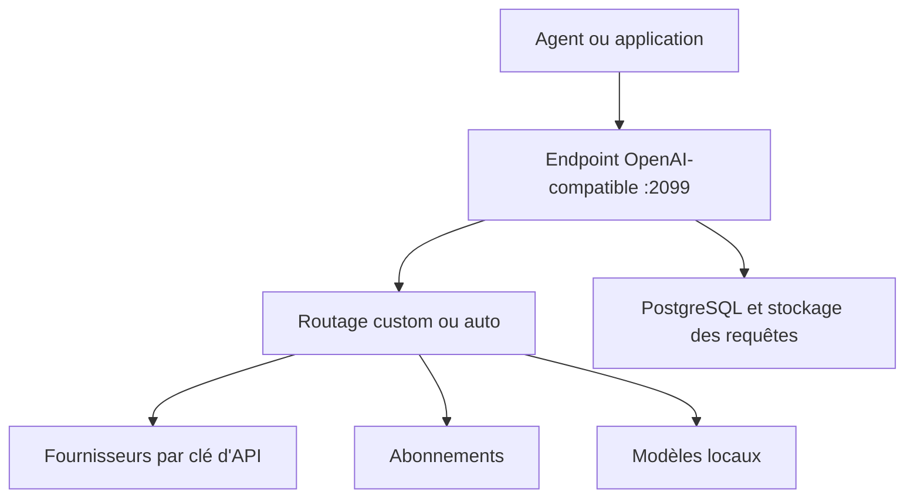

# mnfst/manifest

> Passerelle LLM open source : un endpoint compatible OpenAI qui route chaque requête vers le bon modèle.

## Le problème
Utiliser plusieurs fournisseurs, abonnements et modèles locaux oblige à gérer autant d'API, de factures et de reprises sur erreur.

## Ce que ça fait vraiment
Manifest expose un point d'entrée OpenAI-compatible. Avec `"model": "auto"`, il choisit le modèle. Il relie plus de 300 modèles via 35 connexions de fournisseurs, 18 formules d'abonnement et des modèles locaux (Ollama, LM Studio, llama.cpp). Il journalise les corps de requêtes, suit les dépenses avec notifications et limites, et bascule sur un autre modèle en cas d'échec.

## Comment c'est branché
Pas d'architecture fournie dans le bloc ; schéma limité au README.


## Essayer
```bash
bash <(curl -sSL https://raw.githubusercontent.com/mnfst/llm-gateway/main/docker/install.sh)
```
Puis ouvrir http://localhost:2099 ; le premier compte créé devient administrateur.

## Coût et pièges
Auto-hébergé gratuit ; le cloud Manifest coûte 19 dollars par mois. Les fournisseurs restent facturés selon tes clés. L'ancien chemin npm n'est plus supporté. Les déploiements à volume sont mono-instance.

## Ce que ce n'est pas
Pas un modèle ni un fournisseur : il redirige vers les tiens. Les abonnements réutilisés peuvent dépendre des conditions de ces services, non détaillées ici.

## Alternatives
OpenRouter : cité comme fournisseur (300+ modèles), non comme concurrent direct.

## Pour toi
À surveiller : un point d'entrée unique avec suivi des coûts est utile en MLOps, à comparer à ta passerelle actuelle.

