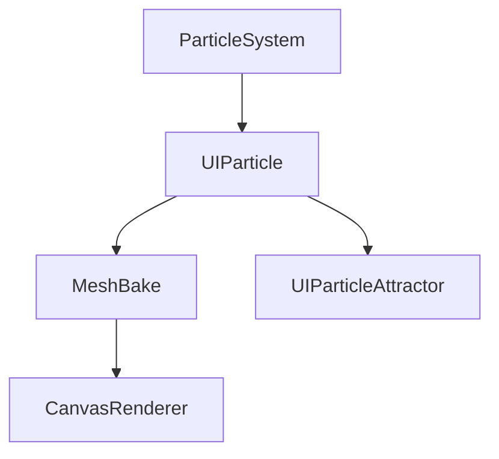

# mob-sakai/ParticleEffectForUGUI

> Unity package that renders particle systems in the uGUI UI, with masks and sorting.

## The problem
A particle system in a Unity Canvas is hard to sort and mask, or requires a camera and a RenderTexture.

## What it actually does
The `UIParticle` component "bakes" the particle system's mesh via MeshBake and renders it through `CanvasRenderer`: sortable, maskable (Mask, RectMask2D), URP/HDRP compatible, allocation-free. Mesh sharing for large numbers of effects; `UIParticleAttractor` attracts particles.

## How it is wired


## Trying it
```bash
openupm add com.coffee.ui-particle
# ou dans manifest.json : "com.coffee.ui-particle": "https://github.com/mob-sakai/ParticleEffectForUGUI.git"
```

## Cost and gotchas
Unity 2018.3+. UI shaders recommended, 65535 vertex limit, built-in shaders not supported.

## What it is not
Not a game engine nor a data tool. Depends on uGUI.

## Alternatives
UIParticleSystem (Unity forum script, compared in the README).

## For you
Ignore: specific to Unity game development.
