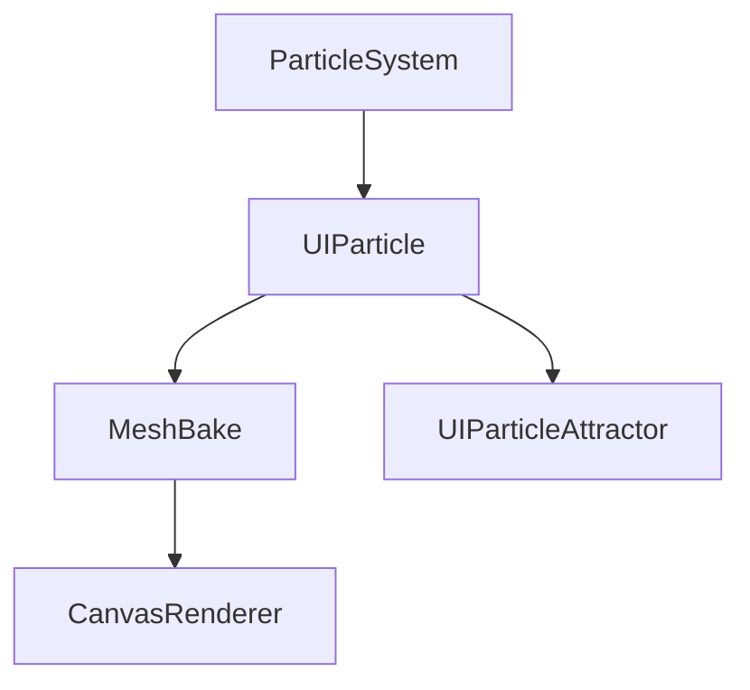

# mob-sakai/ParticleEffectForUGUI

> Paquet Unity qui rend des systèmes de particules dans l'UI uGUI, avec masques et tri.

## Le problème
Un système de particules dans un Canvas Unity se trie et se masque mal, ou demande une caméra et une RenderTexture.

## Ce que ça fait vraiment
Le composant `UIParticle` « cuit » le mesh du système de particules via MeshBake et le rend par `CanvasRenderer` : triable, masquable (Mask, RectMask2D), compatible URP/HDRP, sans allocation. Partage de mesh pour les grands nombres d'effets ; `UIParticleAttractor` attire les particules.

## Comment c'est branché


## Essayer
```bash
openupm add com.coffee.ui-particle
# ou dans manifest.json : "com.coffee.ui-particle": "https://github.com/mob-sakai/ParticleEffectForUGUI.git"
```

## Coût et pièges
Unity 2018.3+. Shaders UI recommandés, limite de 65535 sommets, shaders intégrés non pris en charge.

## Ce que ce n'est pas
Pas un moteur de jeu ni un outil data. Dépend d'uGUI.

## Alternatives
UIParticleSystem (script du forum Unity, comparé dans le README).

## Pour toi
Ignorer : spécifique au développement de jeux Unity.

