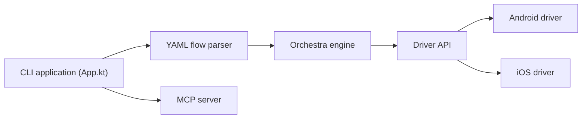

# mobile-dev-inc/Maestro

> End-to-end UI testing framework (Android, iOS, web) in YAML, with an MCP server for coding agents.

## The problem
Mobile UI tests are fragile and slow to write (Appium, Espresso), and agents cannot see the device.

## What it actually does
YAML flows (`launchApp`, `tapOn`, `assertVisible`) are parsed, validated, then executed through accessibility on an emulator, simulator, browser or physical Android device. The CLI embeds an MCP server so that the agent can control the device. Maestro Studio (IDE, not open source) and Maestro Cloud (paid, 7-day trial) complete the offering.

## How it is wired


## Trying it
```bash
java -version
curl -fsSL "https://get.maestro.mobile.dev" | bash
```
Then `maestro mcp` for the agent, according to the docs.

## Cost and gotchas
Free locally. Java 17+. Physical iOS devices are not supported. Cloud is paid; the code calls Maestro services (analytics, updates, AI via Anthropic/OpenAI).

## What it is not
Not a tool for testing ML models. Studio is not open source.

## Alternatives
The README mentions Appium, Espresso, UIAutomator, XCTest, Selenium, Playwright.

## For you
Worth watching: only if you test mobile applications; the MCP server is of interest for agent-device loops.
