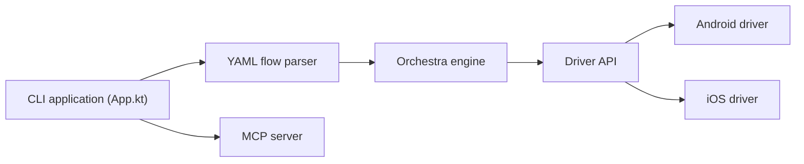

# mobile-dev-inc/Maestro

> Framework de tests UI de bout en bout (Android, iOS, web) en YAML, avec serveur MCP pour agents de code.

## Le problème
Les tests UI mobiles sont fragiles et longs à écrire (Appium, Espresso), et les agents ne voient pas l'appareil.

## Ce que ça fait vraiment
Des flux YAML (`launchApp`, `tapOn`, `assertVisible`) sont analysés, validés puis exécutés via accessibilité sur émulateur, simulateur, navigateur ou appareil Android physique. Le CLI embarque un serveur MCP pour que l'agent contrôle l'appareil. Maestro Studio (IDE, non libre) et Maestro Cloud (payant, essai 7 jours) complètent.

## Comment c'est branché


## Essayer
```bash
java -version
curl -fsSL "https://get.maestro.mobile.dev" | bash
```
Puis `maestro mcp` pour l'agent, selon la doc.

## Coût et pièges
Gratuit en local. Java 17+. Appareils iOS physiques non pris en charge. Cloud payant ; le code appelle des services Maestro (analytiques, mises à jour, IA via Anthropic/OpenAI).

## Ce que ce n'est pas
Pas un outil de test de modèles ML. Studio n'est pas open source.

## Alternatives
Le README cite Appium, Espresso, UIAutomator, XCTest, Selenium, Playwright.

## Pour toi
À surveiller : seulement si tu testes des applications mobiles ; le serveur MCP intéresse pour des boucles agent-appareil.

