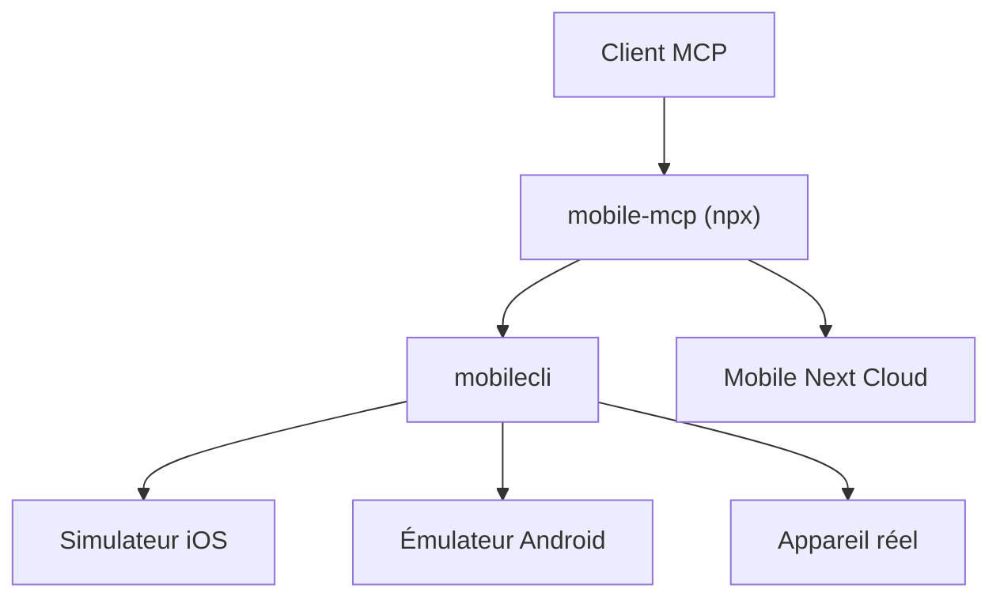

# mobile-next/mobile-mcp

> MCP server to drive iOS and Android applications (simulators, emulators, real devices) from an agent.

## The problem
Automating native mobile applications requires XCUITest, Espresso and platform-specific code for each one.

## What it actually does
Exposes MCP tools: list devices, launch and install apps, tap, swipe, capture the screen, read logs and crashes. It favors the accessibility tree (no vision model needed) and falls back on screenshots and coordinates. stdio or streamable HTTP mode, with an optional Bearer token.

## How it is wired


## Trying it
```bash
npx @mobilenext/mobile-mcp@latest install
claude mcp add mobile-mcp -- npx -y @mobilenext/mobile-mcp@latest
npx @mobilenext/mobile-mcp@latest --listen 3000
MOBILEMCP_DISABLE_TELEMETRY=1 npx @mobilenext/mobile-mcp@latest
```

## Cost and gotchas
Free locally; Xcode, Android Platform Tools and Node 20+ required. Anonymous telemetry (PostHog, Scarf) is on by default; the device cloud is a separate service. Without `MOBILEMCP_AUTH`, the HTTP server accepts unauthenticated connections.

## What it is not
Not a deterministic testing framework: for that the README points to Mobilewright.

## Alternatives
Mobilewright, for reproducible tests in CI.

## For you
Worth watching: handy to give an agent access to a phone, with telemetry to disable and a token to set before any network mode.
