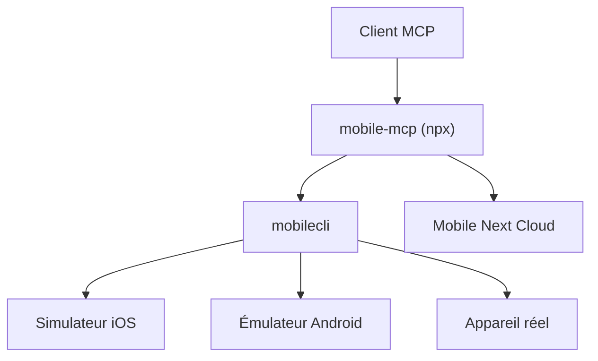

# mobile-next/mobile-mcp

> Serveur MCP pour piloter des applications iOS et Android (simulateurs, émulateurs, vrais appareils) par un agent.

## Le problème
Automatiser des applications mobiles natives demande XCUITest, Espresso et du code propre à chaque plateforme.

## Ce que ça fait vraiment
Expose des outils MCP : lister les appareils, lancer et installer des apps, taper, balayer, capturer l'écran, lire les journaux et plantages. Il privilégie l'arbre d'accessibilité (sans modèle de vision) et retombe sur les captures et coordonnées. Mode stdio ou HTTP streamable, avec jeton Bearer optionnel.

## Comment c'est branché


## Essayer
```bash
npx @mobilenext/mobile-mcp@latest install
claude mcp add mobile-mcp -- npx -y @mobilenext/mobile-mcp@latest
npx @mobilenext/mobile-mcp@latest --listen 3000
MOBILEMCP_DISABLE_TELEMETRY=1 npx @mobilenext/mobile-mcp@latest
```

## Coût et pièges
Gratuit en local ; Xcode, Android Platform Tools et Node 20+ requis. Télémétrie anonyme (PostHog, Scarf) active par défaut ; le cloud d'appareils est un service à part. Sans `MOBILEMCP_AUTH`, le serveur HTTP accepte les connexions non authentifiées.

## Ce que ce n'est pas
Pas un framework de test déterministe : pour cela le README renvoie vers Mobilewright.

## Alternatives
Mobilewright, pour des tests reproductibles en CI.

## Pour toi
À surveiller : pratique pour donner à un agent un accès à un téléphone, avec télémétrie à désactiver et un jeton à poser avant tout mode réseau.

