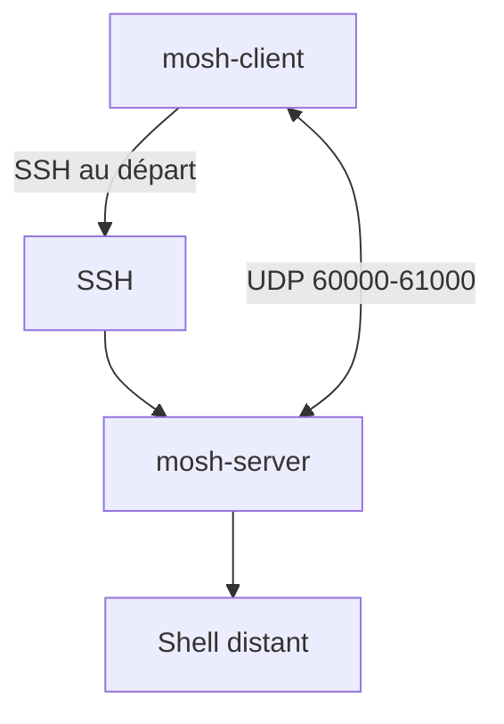

# mobile-shell/mosh

> Remote terminal that survives network drops and IP address changes, for anyone who works over SSH on the move.

## The problem
An SSH session dies when the laptop goes to sleep or the network changes, and every keystroke suffers from latency.

## What it actually does
Mosh relies on SSH to authenticate, then launches `mosh-server`, which talks over UDP with `mosh-client`. The session stays alive across sleep or an IP change, and the client displays in advance the predicted local echo of keystrokes. No privileged (root) code. No port forwarding and no X forwarding.

## How it is wired


## Trying it
```bash
mosh [user@]host
mosh --client=PATH --server=PATH [user@]host
./autogen.sh
./configure
make
make check
```

## Cost and gotchas
Free. You need `mosh-server` on the remote machine and open UDP ports (60000 to 61000 by default). A UTF-8 environment is required. GPL-3.0 license.

## What it is not
Not a full replacement for SSH: no port forwarding, no X forwarding, no non-interactive use.

## Alternatives
- No alternative named in the README.

## For you
Adopt: useful whenever you connect to a GPU or compute server from an unstable network, with minimal installation cost.
