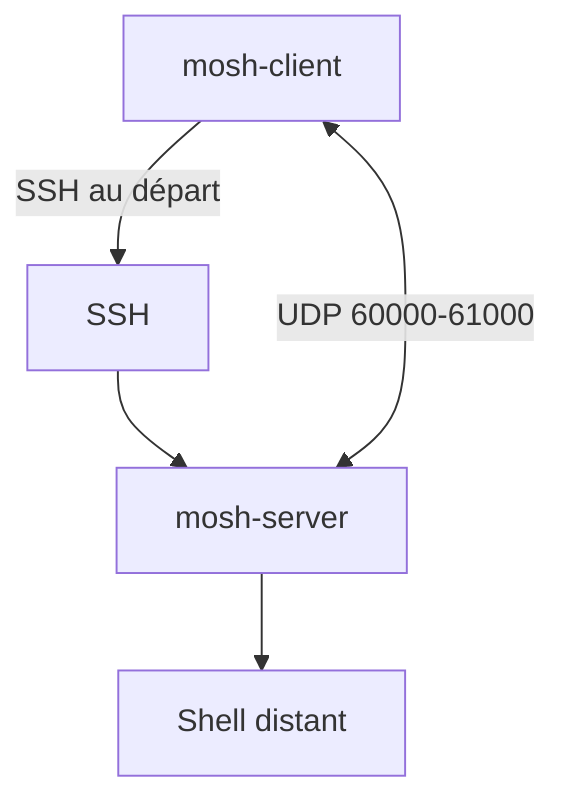

# mobile-shell/mosh

> Terminal distant qui survit aux coupures réseau et aux changements d'adresse IP, pour qui travaille en SSH nomade.

## Le problème
Une session SSH tombe quand le portable se met en veille ou que le réseau change, et chaque frappe subit la latence.

## Ce que ça fait vraiment
Mosh s'appuie sur SSH pour s'authentifier, puis lance `mosh-server`, qui parle en UDP avec `mosh-client`. La session reste vivante en cas de veille ou de changement d'IP, et le client affiche en avance l'écho local prédit des frappes. Pas de code privilégié (root). Pas de redirection de port ni de X forwarding.

## Comment c'est branché


## Essayer
```bash
mosh [user@]host
mosh --client=PATH --server=PATH [user@]host
./autogen.sh
./configure
make
make check
```

## Coût et pièges
Gratuit. Il faut `mosh-server` sur la machine distante et des ports UDP ouverts (60000 à 61000 par défaut). Un environnement UTF-8 est requis. Licence GPL-3.0.

## Ce que ce n'est pas
Pas un remplaçant total de SSH : pas de redirection de port, pas de X forwarding, pas d'usage non interactif.

## Alternatives
- Aucune alternative nommée dans le README.

## Pour toi
À adopter : utile dès que tu te connectes à un serveur GPU ou de calcul depuis un réseau instable, avec un coût d'installation minime.

