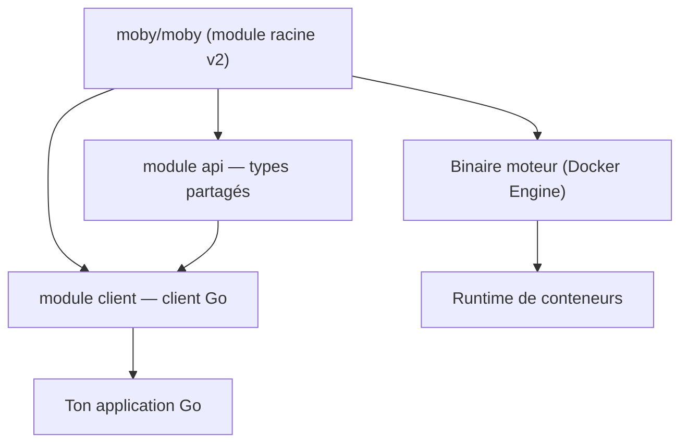

# moby/moby

> The open-source foundation of Docker Engine: components to assemble for building your own runtime environment.

## The problem
Building a container-based system requires rewriting the build process, the registry, and the runtime. Moby provides these pre-tested components.

## What it actually does
A "Lego-like" system: building tools, registry, orchestration, runtime, and components that can be assembled into container systems. Docker Engine is its primary consumer. Starting with Docker v29 (November 2025), the Go module `github.com/docker/docker` is deprecated; the supported public modules are `github.com/moby/moby/client` and `github.com/moby/moby/api`, which are versioned independently. The root module, "v2", produces binaries and is not a library.

## How it is wired


## Trying it
```diff
- import "github.com/docker/docker/client"
+ import "github.com/moby/moby/client"
```

## Cost and gotchas
Free, Apache 2.0. The README warns that use and transfer may be subject to US export restrictions. The `docker-vX` tags should not be obtained using `go get`.

## What it is not
Not a commercially supported product: for this, use Docker Desktop or Mirantis Container Runtime. Not a place for support or feature requests for Docker products. The root module offers no guarantee of API stability.

## Alternatives
- Docker Desktop / Mirantis Container Runtime: If you need commercial support.
- prometheus/common, client-golang (mentioned elsewhere): A repository model designed as a library.

## For you
Things to watch out for: This is useful if your Go code is using Docker – the only concrete action to plan for is the import migration.
