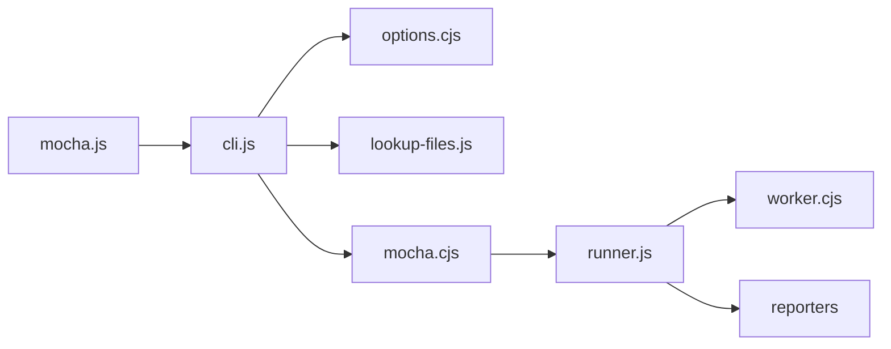

# mochajs/mocha

> JavaScript testing framework for Node.js and the browser, for JS developers who want a configurable runner.

## The problem
Writing and running JS tests requires a runner that discovers files, structures suites and displays results.

## What it actually does
A CLI (or a JS API) loads the options, finds the test files, then the interfaces define suites and tests. The runner executes and the reporters display. Parallel mode spreads files across worker processes; a browser entry point exists. The supplied README contains only links (docs, Discord, contributing): usage is described elsewhere.

## How it is wired


## Trying it
```bash
# Aucune commande d'installation ni d'usage dans le README fourni
# (il renvoie vers la documentation en ligne).
```

## Cost and gotchas
Free. Maintained exclusively by volunteers, according to the README: the pace depends on their availability. 222 open issues.

## What it is not
Not an "all-in-one" runner: assertions and mocks must be added yourself. The supplied README does not explain how it works.

## Alternatives
No alternative named in the README.

## For you
Mostly useful if you have Node/JS code to test (tools, dashboard front ends); for Python data work, off topic. Very widely installed, so safe to adopt in that case.
