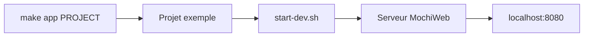

# mochi/mochiweb

> Erlang library for building lightweight HTTP servers, for Erlang developers.

## The problem
Creating an HTTP server in Erlang without starting from scratch.

## What it actually does
Provides the building blocks for HTTP servers in Erlang; one command generates a sample project (`make app PROJECT=…`) and a development start script. Example in `examples/example_project`. The README warns against OTP versions 21.2 to 21.2.2 (SSL regression).

## How it is wired


## Trying it
```bash
git clone git://github.com/mochi/mochiweb.git
cd mochiweb
make app PROJECT=exampleName
cd ../exampleName/
make
./start-dev.sh
```

## Cost and gotchas
Free. Requires Erlang/OTP and Rebar; avoid OTP 21.2 to 21.2.2.

## What it is not
Not a full web framework: the README describes a library, with general qualifiers and no details.

## Alternatives
No alternative named in the README.

## For you
Ignore: Erlang and HTTP server, outside your data/AI/MLOps stack.
