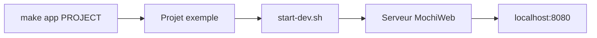

# mochi/mochiweb

> Bibliothèque Erlang pour construire des serveurs HTTP légers, pour développeurs Erlang.

## Le problème
Créer un serveur HTTP en Erlang sans repartir de zéro.

## Ce que ça fait vraiment
Fournit les briques pour des serveurs HTTP en Erlang ; une commande génère un projet d'exemple (`make app PROJECT=…`) et un script de démarrage de développement. Exemple dans `examples/example_project`. Le README met en garde contre les versions OTP 21.2 à 21.2.2 (régression SSL).

## Comment c'est branché


## Essayer
```bash
git clone git://github.com/mochi/mochiweb.git
cd mochiweb
make app PROJECT=exampleName
cd ../exampleName/
make
./start-dev.sh
```

## Coût et pièges
Gratuit. Exige Erlang/OTP et Rebar ; éviter OTP 21.2 à 21.2.2.

## Ce que ce n'est pas
Pas un framework web complet : le README décrit une bibliothèque, avec des qualificatifs généraux sans détails.

## Alternatives
Aucune alternative nommée dans le README.

## Pour toi
À ignorer : Erlang et serveur HTTP, hors de ta pile data/IA/MLOps.

