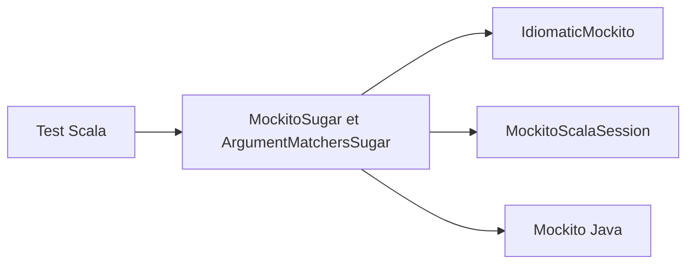

# mockito/mockito-scala

> Scala layer over Mockito for writing more readable test mocks and verifications.

## The problem
Using Java Mockito from Scala gives compilation errors on overloaded methods, by-name arguments and value classes.

## What it actually does
The library adds a Scala syntax: `aMock.bar returns "mocked!"`, `aMock.bar was called`, `*` and `eqTo` matchers, an `ArgCaptor`, strict sessions that detect misused mocks, and an experimental `expect` DSL. Separate artifacts exist for ScalaTest, Specs2, Cats and Scalaz.

## How it is wired
Simplified diagram based on the sheet, no diagram provided.


## Trying it
```bash
# Aucune commande de build dans le README.
# Coordonnées Maven Central : org.mockito:mockito-scala_[scala-version]:[version]
# Ne pas déclarer mockito-core : mockito-scala le tire lui-même.
```

## Cost and gotchas
Java 11 minimum since version 2.0.0 and Scala 2.11 dropped; Scala and Java are not in the list of prerequisites. In Scala 3, methods that wrap `mock[T]` must be `inline`, otherwise stubs fail silently. The README is truncated in this block beyond Default Answers.

## What it is not
Not a testing tool for Python or data. The `expect` DSL is experimental and may change between minor versions.

## Alternatives
Mockito (Java): the original library, cited as a separate project.

## For you
Ignore: useful only to a team writing tests in Scala, outside the Python data, AI or MLOps scope.
