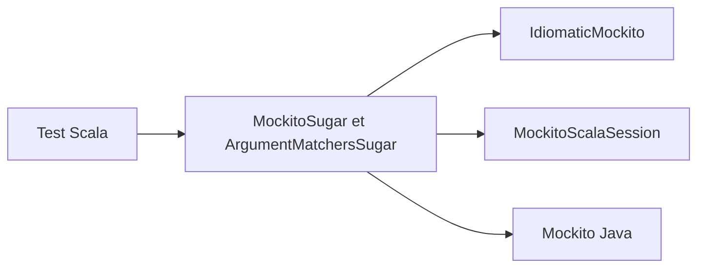

# mockito/mockito-scala

> Surcouche Scala de Mockito pour écrire des mocks et des vérifications de tests plus lisibles.

## Le problème
Utiliser Mockito Java depuis Scala donne des erreurs de compilation sur les méthodes surchargées, les arguments par nom et les classes valeur.

## Ce que ça fait vraiment
La bibliothèque ajoute une syntaxe Scala : `aMock.bar returns "mocked!"`, `aMock.bar was called`, des matchers `*` et `eqTo`, un `ArgCaptor`, des sessions strictes qui repèrent les mocks mal utilisés, et un DSL expérimental `expect`. Des artefacts séparés existent pour ScalaTest, Specs2, Cats et Scalaz.

## Comment c'est branché
Schéma simplifié d'après la fiche, sans diagramme fourni.


## Essayer
```bash
# Aucune commande de build dans le README.
# Coordonnées Maven Central : org.mockito:mockito-scala_[scala-version]:[version]
# Ne pas déclarer mockito-core : mockito-scala le tire lui-même.
```

## Coût et pièges
Java 11 minimum depuis la version 2.0.0 et Scala 2.11 abandonné ; Scala ou Java n'existent pas dans la liste des prérequis. En Scala 3, les méthodes qui enveloppent `mock[T]` doivent être `inline`, sinon les stubs échouent en silence. Le README est tronqué dans ce bloc au-delà des Default Answers.

## Ce que ce n'est pas
Pas un outil de test pour Python ou data. Le DSL `expect` est expérimental et peut changer entre versions mineures.

## Alternatives
Mockito (Java) : la bibliothèque d'origine, citée comme projet distinct.

## Pour toi
À ignorer : utile seulement à une équipe qui écrit des tests en Scala, hors du périmètre data, IA ou MLOps en Python.

