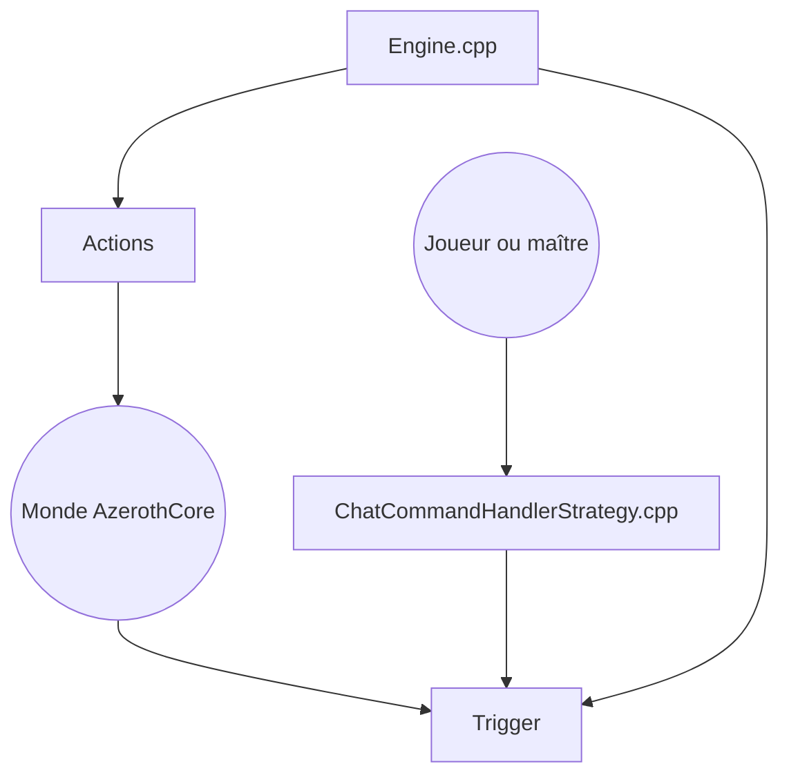

# mod-playerbots/mod-playerbots

> AzerothCore module that adds simulated players to an online game server.

## The problem
A private MMO server is empty without players, and playing alone is nothing like the group experience.

## What it actually does
Lets you log in your alternate characters as bots, and have random bots roam around doing quests, raids and battlegrounds. A decision engine evaluates triggers and strategies, queues actions and executes them in the world. Bots are commanded by chat; client addons exist. Extensive configuration.

## How it is wired


## Trying it
```bash
git clone https://github.com/mod-playerbots/azerothcore-wotlk.git --branch=Playerbot
cd azerothcore-wotlk/modules
git clone https://github.com/mod-playerbots/mod-playerbots.git --branch=master
```

## Cost and gotchas
Free. Requires the AzerothCore fork (Playerbot branch): the standard repository does not work. Documentation sometimes incomplete; the test-staging branch is unstable. 270 open issues.

## What it is not
Not a module for just any game server. Not AI in the learning sense: strategies based on triggers and actions.

## Alternatives
The README says it builds on IKE3's Playerbots, from which it derives.

## For you
Ignore: online game mod unrelated to your data, AI or MLOps work.
