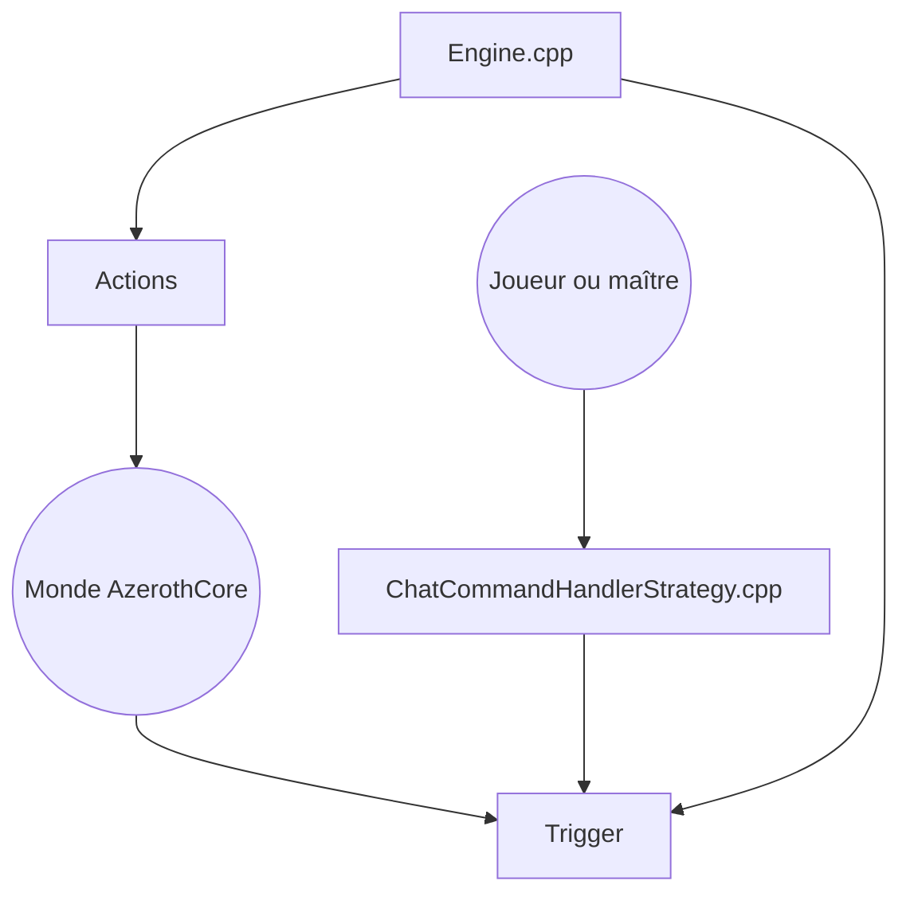

# mod-playerbots/mod-playerbots

> Module AzerothCore qui ajoute des joueurs simulés à un serveur de jeu en ligne.

## Le problème
Un serveur privé de MMO est vide sans joueurs, et jouer seul ne ressemble pas à l'expérience en groupe.

## Ce que ça fait vraiment
Permet de connecter tes personnages secondaires comme bots, et de faire vagabonder des bots aléatoires qui font des quêtes, des raids et des champs de bataille. Un moteur de décision évalue déclencheurs et stratégies, met des actions en file et les exécute dans le monde. Les bots se commandent par chat ; des addons clients existent. Paramétrage riche.

## Comment c'est branché


## Essayer
```bash
git clone https://github.com/mod-playerbots/azerothcore-wotlk.git --branch=Playerbot
cd azerothcore-wotlk/modules
git clone https://github.com/mod-playerbots/mod-playerbots.git --branch=master
```

## Coût et pièges
Gratuit. Exige le fork AzerothCore (branche Playerbot) : le dépôt standard ne fonctionne pas. Documentation parfois incomplète ; branche test-staging instable. 270 issues ouvertes.

## Ce que ce n'est pas
Pas un module pour n'importe quel serveur de jeu. Pas de l'IA au sens apprentissage : des stratégies à base de déclencheurs et d'actions.

## Alternatives
Le README dit s'appuyer sur les Playerbots d'IKE3, dont il est issu.

## Pour toi
À ignorer : mod de jeu en ligne sans rapport avec ton métier data, IA ou MLOps.

