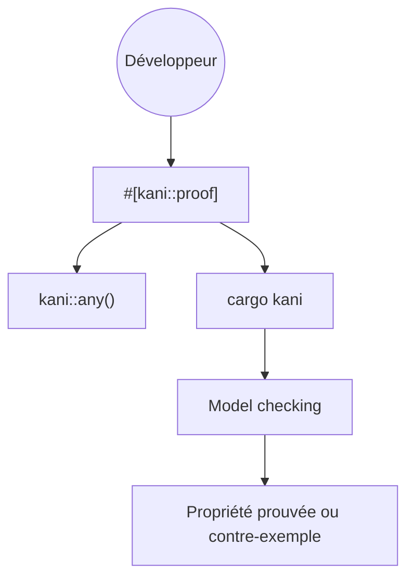

# model-checking/kani

> Bit-precise model checker for Rust, which proves code safety and correctness.

## The problem
Tests cover only a few inputs, and `unsafe` code escapes the compiler.

## What it actually does
- Checks undefined behavior, panics and arithmetic overflows.
- You write a "harness" with `kani::any()`: all possible values are explored.
- Accepts assertions or function contracts.
- A GitHub Action lets you integrate it into CI.

## How it is wired
Simplified diagram based on the sheet, no diagram provided.


## Trying it
```bash
cargo install --locked kani-verifier
cargo kani setup
```

## Cost and gotchas
Free. Rust 1.58 or later, Linux or macOS. 546 open issues. MIT and Apache-2.0 license.

## What it is not
Not a replacement for tests: it proves properties on harnesses you write. The scope depends on what the solver can explore, not detailed.

## Alternatives
No alternative named in the README.

## For you
Worth watching: relevant if you write critical Rust, for example an inference engine; off-topic for Python.
