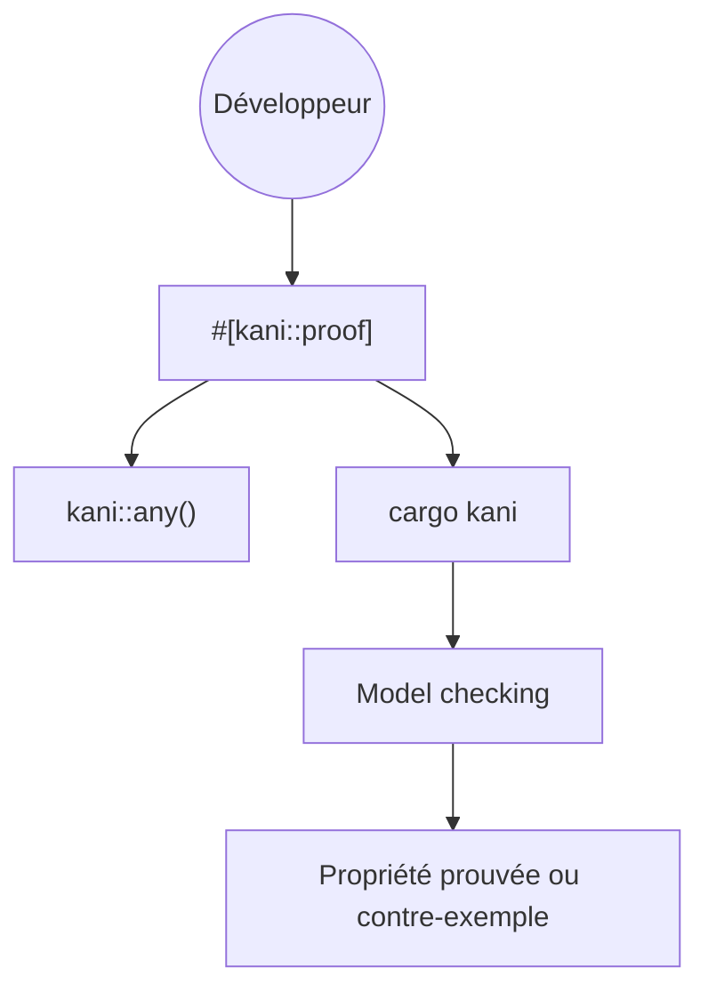

# model-checking/kani

> Vérificateur de modèle précis au bit pour Rust, qui prouve sûreté et correction du code.

## Le problème
Les tests ne couvrent que quelques entrées, et le code `unsafe` échappe au compilateur.

## Ce que ça fait vraiment
- Vérifie les comportements indéfinis, les paniques et les débordements arithmétiques.
- Tu écris un « harnais » avec `kani::any()` : toutes les valeurs possibles sont explorées.
- Accepte des assertions ou des contrats de fonction.
- Une action GitHub permet de l'intégrer au CI.

## Comment c'est branché
Schéma simplifié d'après la fiche, sans diagramme fourni.


## Essayer
```bash
cargo install --locked kani-verifier
cargo kani setup
```

## Coût et pièges
Gratuit. Rust 1.58 ou plus, Linux ou macOS. 546 tickets ouverts. Licence MIT et Apache-2.0.

## Ce que ce n'est pas
Pas un remplaçant des tests : il prouve des propriétés sur des harnais que tu écris. La portée dépend de ce que le solveur peut explorer, non détaillé.

## Alternatives
Aucune alternative nommée dans le README.

## Pour toi
À surveiller : pertinent si tu écris du Rust critique, par exemple un moteur d'inférence ; hors sujet en Python.

